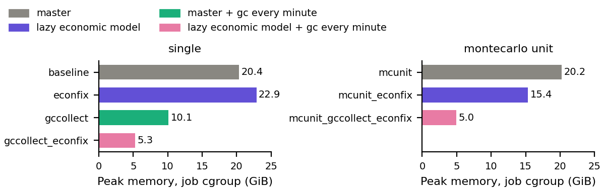
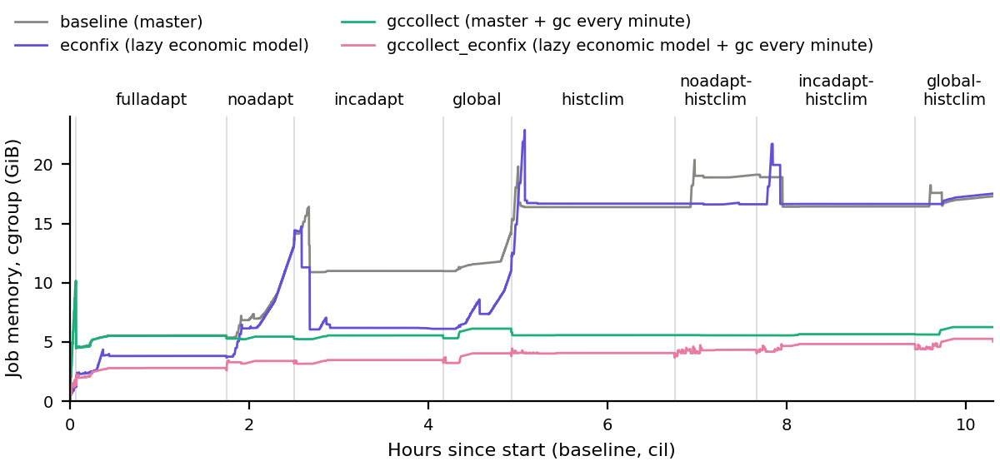
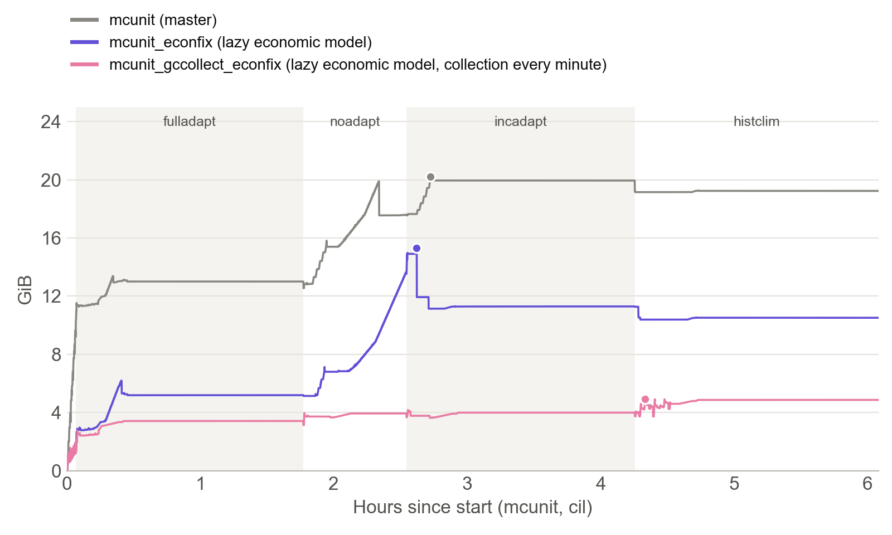

# impact-calculations-experiments

This repository collects profiling runs of the impact-calculations
projection system on Midway. The aim is to see where memory and time go
when projecting agricultural impacts, since the memory a job asks for is
what decides its cost in service units and how many jobs fit on a node.

The runs come in two shapes. A single projects one combination of climate
model, RCP, SSP and IAM (here CCSM4, rcp85, SSP3 and high) and writes eight
files. A montecarlo unit covers one batch for one such combination (here
batch 0 with the same choices) and writes four files. A full Monte Carlo
run of one crop is made of about 5,850 of these units. Quick runs are
similar jobs restricted to one region (rcp45 and low, four files).

Three experiments build on these runs. The
[quick runs](experiments/2026-11-agri-memory/README.md) look for where
memory goes, the [full runs](experiments/2026-11-agri-memory-full/README.md)
measure the peak with all regions, and the
[garbage collection runs](experiments/2026-11-agri-memory-gc/README.md)
repeat the full single and the montecarlo unit while freeing memory every
minute, to test what drives that peak.

Memory and time were measured with a per-second sampler, memray and
pyinstrument, which run inside the process (py-spy cannot run on Midway).
The Slurm jobs, configs and tools are in [profiling/](profiling/), and all runs are compared in
[this notebook](https://c1587s.github.io/impact-calculations-experiments/dashboard/site/).

## Summary

Together, the three experiments give a first picture of the memory of an agriculture projection. All peaks below are those of the job cgroup.

In these runs, the [lazy economic model](https://github.com/ClimateImpactLab/impact-calculations/tree/econmodel-memory) alone did not change the peak of a full single, which stayed at 20.4 GiB on master. It did lower the peak of a montecarlo unit, from 20.2 to 15.4 GiB, since the unit keeps all ten economic models loaded for the whole run. With a collection every minute as well, the montecarlo unit peaked at 5.0 GiB, and its outputs were identical to those on master.

The runs suggest that most of the peak in a full run is weather data that Python frees only at a full garbage collection. With a collection every minute, the single peaked at 10.1 GiB on master. With both the lazy economic model and a collection every minute, it peaked at 5.3 GiB, against 20.4 GiB on master. In these runs, collecting every minute took 3.0% to 3.8% of the run time.

The projection appears to use a single core, about 96% of it, in every setup, and one quick run with two cores took about the same time as with one. A montecarlo unit writes four files instead of eight, and in these runs it took about 60% of a single's time on master, 6.1 against 10.3 h on cil. Outputs were identical in every run except the histclim file of mcunit_econfix, which used a different year-order seed.

## [2026-11-agri-memory](experiments/2026-11-agri-memory/README.md)

The quick runs project the winter wheat single for one region, so the peaks and timings below hold for quick runs only. In the full single the peak came later, in the histclim covariates, and the lazy economic model did not lower it. In the full montecarlo unit it lowered the peak from 20.2 to 15.4 GiB ([full-run report](experiments/2026-11-agri-memory-full/README.md)).

Timelines open in Perfetto and take about 10 seconds to load.

| experiment | main finding | links |
|------------|--------------|-------|
| baseline-quick | Peaked at 10.3 GiB while loading the economic models. | [run timeline][p-base], [run details][m-base] |
| cores2-quick | Two cores took 30.6 min against 30.7 min with one. | [run timeline][p-cores2], [run details][m-cores2], [output check][c-cores2] |
| oneecon-quick | One economic model instead of ten: peak 5.5 GiB, startup 28 s instead of 231 s. | [run timeline][p-oneecon], [run details][m-oneecon], [output check][c-oneecon] |
| memray-quick | 94.5% of the 9.9 GiB tracked at the peak was allocated in `NewSSPEconomicModel.__init__`. | [memory by code line][memray-fg], [run timeline][p-memray], [run details][m-memray], [output check][c-memray] |
| pyinstrument-quick | 70% of the time went to climate covariates. | [time by function][pyi-html], [time by function, interactive][pyi-ss], [run timeline][p-pyi], [run details][m-pyi], [output check][c-pyi] |
| econfix_check | The lazy economic model gave identical values. One model took 78.8 MB instead of 879.4 MB. | [output check][c-check] |
| econfix-quick | The baseline with the lazy economic model peaked at 5.3 GiB instead of 10.3. Outputs matched. | [run timeline][p-econfix], [run details][m-econfix], [output check][c-econfix] |
| mortality-quick | Mortality on master, the reference for the lazy economic model: peak 10.4 GiB. | [run timeline][p-mort], [run details][m-mort] |
| mortality_econfix-quick | Mortality with the lazy economic model peaked at 6.4 GiB, outputs equal to master. | [run timeline][p-mortfix], [run details][m-mortfix], [output check][c-mortfix] |

## [2026-11-agri-memory-full](experiments/2026-11-agri-memory-full/README.md)

The full runs project the winter wheat single and one montecarlo unit with all regions. In these runs memory peaked hours into the run, not at startup. Peaks are those of the job cgroup.

Timelines open in Perfetto and take about 10 seconds to load.

| experiment | main finding | links |
|------------|--------------|-------|
| baseline | Peaked at 20.4 GiB after 7 h, in the covariates of a histclim variant. | [run timeline][fp-base], [run details][fm-base] |
| econfix | The lazy economic model used 8.3 GiB less at startup and up to 4.9 GiB less until histclim, then about the same memory. Peaked at 22.9 GiB. | [run timeline][fp-econfix], [run details][fm-econfix] |
| mcunit | A montecarlo unit with all ten economic models kept peaked at 20.2 GiB, close to the single's 20.4 GiB. | [run timeline][fp-mcunit], [run details][fm-mcunit] |
| mcunit_econfix | In the montecarlo unit, which keeps the ten economic models loaded, the lazy economic model lowered the peak from 20.2 to 15.4 GiB. | [run timeline][fp-mcfix], [run details][fm-mcfix] |

## [2026-11-agri-memory-gc](experiments/2026-11-agri-memory-gc/README.md)

The garbage collection runs repeat the full winter wheat single, on master and with the lazy economic model, and the montecarlo unit with the lazy economic model, all with a full garbage collection every minute on caslake. Peaks are those of the job cgroup.

Timelines open in Perfetto and take about 10 seconds to load.

| experiment | main finding | links |
|------------|--------------|-------|
| gccollect | Master peaked at 10.1 GiB instead of 20.4, at startup. The collections took 3.0% of the run and outputs were identical. | [run timeline][gp-gc], [run details][gm-gc], [output check][gk-gc], [collection log][gl-gc] |
| gccollect_econfix | With the lazy economic model the peak was 5.3 GiB instead of 22.9. The collections took 3.4% of the run and outputs were identical. | [run timeline][gp-gcfix], [run details][gm-gcfix], [output check][gk-gcfix], [collection log][gl-gcfix] |
| mcunit_gccollect_econfix | In the montecarlo unit, the lazy economic model with the collections peaked at 5.0 GiB, against 15.4 without them and 20.2 on master. The collections took 3.8% of the run and outputs were identical to mcunit. | [run timeline][gp-mcgcfix], [run details][gm-mcgcfix], [output check][gk-mcgcfix], [collection log][gl-mcgcfix] |

[runs.csv](runs.csv) lists every Slurm job of these experiments, quick tests and failed or cancelled jobs included, and [make_runs_csv.py](profiling/tools/make_runs_csv.py) rebuilds it from the Slurm accounting and the reports.

Reports are served with GitHub Pages. Run timeline links go through [perfetto.html](perfetto.html), which opens the trace in the timeline viewer.

[memray-fg]: https://c1587s.github.io/impact-calculations-experiments/experiments/2026-11-agri-memory/reports/memray-quick/memray-flamegraph.html
[pyi-html]: https://c1587s.github.io/impact-calculations-experiments/experiments/2026-11-agri-memory/reports/pyinstrument-quick/profile.html
[pyi-ss]: https://www.speedscope.app/#profileURL=https%3A%2F%2Fc1587s.github.io%2Fimpact-calculations-experiments%2Fexperiments%2F2026-11-agri-memory%2Freports%2Fpyinstrument-quick%2Fprofile.speedscope.json
[c-check]: https://c1587s.github.io/impact-calculations-experiments/experiments/2026-11-agri-memory/reports/econfix_check/check.json
[p-base]: https://c1587s.github.io/impact-calculations-experiments/perfetto.html?trace=experiments/2026-11-agri-memory/reports/baseline-quick/trace.json
[m-base]: https://c1587s.github.io/impact-calculations-experiments/experiments/2026-11-agri-memory/reports/baseline-quick/manifest.json
[p-cores2]: https://c1587s.github.io/impact-calculations-experiments/perfetto.html?trace=experiments/2026-11-agri-memory/reports/cores2-quick/trace.json
[m-cores2]: https://c1587s.github.io/impact-calculations-experiments/experiments/2026-11-agri-memory/reports/cores2-quick/manifest.json
[c-cores2]: https://c1587s.github.io/impact-calculations-experiments/experiments/2026-11-agri-memory/reports/cores2-quick/check.json
[p-oneecon]: https://c1587s.github.io/impact-calculations-experiments/perfetto.html?trace=experiments/2026-11-agri-memory/reports/oneecon-quick/trace.json
[m-oneecon]: https://c1587s.github.io/impact-calculations-experiments/experiments/2026-11-agri-memory/reports/oneecon-quick/manifest.json
[c-oneecon]: https://c1587s.github.io/impact-calculations-experiments/experiments/2026-11-agri-memory/reports/oneecon-quick/check.json
[p-memray]: https://c1587s.github.io/impact-calculations-experiments/perfetto.html?trace=experiments/2026-11-agri-memory/reports/memray-quick/trace.json
[m-memray]: https://c1587s.github.io/impact-calculations-experiments/experiments/2026-11-agri-memory/reports/memray-quick/manifest.json
[c-memray]: https://c1587s.github.io/impact-calculations-experiments/experiments/2026-11-agri-memory/reports/memray-quick/check.json
[p-pyi]: https://c1587s.github.io/impact-calculations-experiments/perfetto.html?trace=experiments/2026-11-agri-memory/reports/pyinstrument-quick/trace.json
[m-pyi]: https://c1587s.github.io/impact-calculations-experiments/experiments/2026-11-agri-memory/reports/pyinstrument-quick/manifest.json
[c-pyi]: https://c1587s.github.io/impact-calculations-experiments/experiments/2026-11-agri-memory/reports/pyinstrument-quick/check.json
[p-econfix]: https://c1587s.github.io/impact-calculations-experiments/perfetto.html?trace=experiments/2026-11-agri-memory/reports/econfix-quick/trace.json
[m-econfix]: https://c1587s.github.io/impact-calculations-experiments/experiments/2026-11-agri-memory/reports/econfix-quick/manifest.json
[c-econfix]: https://c1587s.github.io/impact-calculations-experiments/experiments/2026-11-agri-memory/reports/econfix-quick/check.json
[p-mort]: https://c1587s.github.io/impact-calculations-experiments/perfetto.html?trace=experiments/2026-11-agri-memory/reports/mortality-quick/trace.json
[m-mort]: https://c1587s.github.io/impact-calculations-experiments/experiments/2026-11-agri-memory/reports/mortality-quick/manifest.json
[p-mortfix]: https://c1587s.github.io/impact-calculations-experiments/perfetto.html?trace=experiments/2026-11-agri-memory/reports/mortality_econfix-quick/trace.json
[m-mortfix]: https://c1587s.github.io/impact-calculations-experiments/experiments/2026-11-agri-memory/reports/mortality_econfix-quick/manifest.json
[c-mortfix]: https://c1587s.github.io/impact-calculations-experiments/experiments/2026-11-agri-memory/reports/mortality_econfix-quick/check.json
[fp-base]: https://c1587s.github.io/impact-calculations-experiments/perfetto.html?trace=experiments/2026-11-agri-memory-full/reports/baseline/trace.json
[fm-base]: https://c1587s.github.io/impact-calculations-experiments/experiments/2026-11-agri-memory-full/reports/baseline/manifest.json
[fp-econfix]: https://c1587s.github.io/impact-calculations-experiments/perfetto.html?trace=experiments/2026-11-agri-memory-full/reports/econfix/trace.json
[fm-econfix]: https://c1587s.github.io/impact-calculations-experiments/experiments/2026-11-agri-memory-full/reports/econfix/manifest.json
[fp-mcunit]: https://c1587s.github.io/impact-calculations-experiments/perfetto.html?trace=experiments/2026-11-agri-memory-full/reports/mcunit/trace.json
[fm-mcunit]: https://c1587s.github.io/impact-calculations-experiments/experiments/2026-11-agri-memory-full/reports/mcunit/manifest.json
[fp-mcfix]: https://c1587s.github.io/impact-calculations-experiments/perfetto.html?trace=experiments/2026-11-agri-memory-full/reports/mcunit_econfix/trace.json
[fm-mcfix]: https://c1587s.github.io/impact-calculations-experiments/experiments/2026-11-agri-memory-full/reports/mcunit_econfix/manifest.json
[gp-gc]: https://c1587s.github.io/impact-calculations-experiments/perfetto.html?trace=experiments/2026-11-agri-memory-gc/reports/gccollect/trace.json
[gm-gc]: https://c1587s.github.io/impact-calculations-experiments/experiments/2026-11-agri-memory-gc/reports/gccollect/manifest.json
[gk-gc]: https://c1587s.github.io/impact-calculations-experiments/experiments/2026-11-agri-memory-gc/reports/gccollect/check.json
[gl-gc]: https://github.com/C1587S/impact-calculations-experiments/blob/main/experiments/2026-11-agri-memory-gc/reports/gccollect/gc.csv
[gp-gcfix]: https://c1587s.github.io/impact-calculations-experiments/perfetto.html?trace=experiments/2026-11-agri-memory-gc/reports/gccollect_econfix/trace.json
[gm-gcfix]: https://c1587s.github.io/impact-calculations-experiments/experiments/2026-11-agri-memory-gc/reports/gccollect_econfix/manifest.json
[gk-gcfix]: https://c1587s.github.io/impact-calculations-experiments/experiments/2026-11-agri-memory-gc/reports/gccollect_econfix/check.json
[gl-gcfix]: https://github.com/C1587S/impact-calculations-experiments/blob/main/experiments/2026-11-agri-memory-gc/reports/gccollect_econfix/gc.csv
[gp-mcgcfix]: https://c1587s.github.io/impact-calculations-experiments/perfetto.html?trace=experiments/2026-11-agri-memory-gc/reports/mcunit_gccollect_econfix/trace.json
[gm-mcgcfix]: https://c1587s.github.io/impact-calculations-experiments/experiments/2026-11-agri-memory-gc/reports/mcunit_gccollect_econfix/manifest.json
[gk-mcgcfix]: https://c1587s.github.io/impact-calculations-experiments/experiments/2026-11-agri-memory-gc/reports/mcunit_gccollect_econfix/check.json
[gl-mcgcfix]: https://github.com/C1587S/impact-calculations-experiments/blob/main/experiments/2026-11-agri-memory-gc/reports/mcunit_gccollect_econfix/gc.csv
