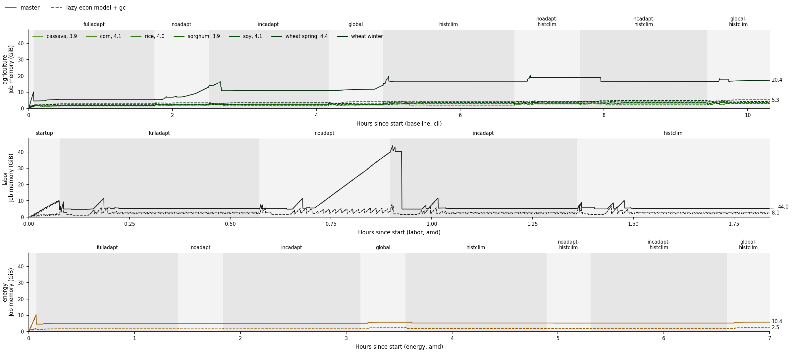

# impact-calculations-experiments

Profiling runs of impact-calculations on Midway, to lower the memory and SUs of the projections. Singles and montecarlo units are rcp85, CCSM4, high, SSP3, units batch 0. Quick runs cover one region, rcp45 and low. Jobs, configs and tools are in [profiling/](profiling/), and all runs are compared in the [notebook](https://c1587s.github.io/impact-calculations-experiments/dashboard/site/).

- [2026-11-agri-memory](experiments/2026-11-agri-memory/README.md): quick runs, where memory goes.
- [2026-11-agri-memory-full](experiments/2026-11-agri-memory-full/README.md): full winter wheat single and montecarlo unit.
- [2026-11-agri-memory-gc](experiments/2026-11-agri-memory-gc/README.md): the same with a full collection every minute.
- [2026-11-amd-round](experiments/2026-11-amd-round/README.md): lazy econ model + gc on the other crops, labor and energy.

## Summary

From the runs:

- On master, memory peaks come from two places: loading the ten
  economic models at startup, and weather data that Python frees only
  at a full garbage collection.
- The lazy econ model plus a full collection every minute lowered the
  peak of every run:

| run | master | lazy + gc |
|-----|--------|-----------|
| winter wheat single | 20.4 GiB | 5.3 GiB |
| other crops, singles (MaxRSS) | 13.0 to 17.6 GiB | 3.7 to 4.3 GiB |
| labor single | 44.0 GiB | 8.1 GiB |
| energy single | 10.4 GiB | 2.5 GiB |
| mortality single | pending | pending |
| winter wheat montecarlo unit | 20.2 GiB | 5.0 GiB |
| labor, three montecarlo units in one job | 52.3 GiB | 8.7 GiB |

- Collections took 1% to 4% of the run time.
- Outputs passed against master in every lazy + gc run.
- Two cores did not speed up a run.

Conclusions:

- With lazy + gc, every run tested fits in about 10 GB, against 13 to
  53 GB on master.

Output checks of the lazy + gc runs. Paths are under `/project/cil/gcp/outputs_newsocioeconomics/`.

| run | reference | result |
|-----|-----------|--------|
| gccollect_econfix | agriculture/wheat_winter/single/rcp85/CCSM4/high/SSP3 | [pass](experiments/2026-11-agri-memory-gc/reports/gccollect_econfix/check.json) |
| cassava_gccollect_econfix | agriculture/cassava/single/rcp85/CCSM4/high/SSP3 | [pass](experiments/2026-11-amd-round/reports/cassava_gccollect_econfix/check.json) |
| corn_gccollect_econfix | agriculture/corn/single/rcp85/CCSM4/high/SSP3 | [pass](experiments/2026-11-amd-round/reports/corn_gccollect_econfix/check.json) |
| rice_gccollect_econfix | agriculture/rice/single/rcp85/CCSM4/high/SSP3 | [pass](experiments/2026-11-amd-round/reports/rice_gccollect_econfix/check.json) |
| sorghum_gccollect_econfix | agriculture/sorghum/single/rcp85/CCSM4/high/SSP3 | [pass](experiments/2026-11-amd-round/reports/sorghum_gccollect_econfix/check.json) |
| soy_gccollect_econfix | agriculture/soy/single/rcp85/CCSM4/high/SSP3 | [pass](experiments/2026-11-amd-round/reports/soy_gccollect_econfix/check.json) |
| wheat_spring_gccollect_econfix | agriculture/wheat_spring/single/rcp85/CCSM4/high/SSP3 | [pass](experiments/2026-11-amd-round/reports/wheat_spring_gccollect_econfix/check.json) |
| labor_gccollect_econfix | labor/single/rcp85/CCSM4/high/SSP3 | [pass](experiments/2026-11-amd-round/reports/labor_gccollect_econfix/check.json) |
| energy_gccollect_econfix | energy/other_energy/single/rcp85/CCSM4/high/SSP3 | [pass](experiments/2026-11-amd-round/reports/energy_gccollect_econfix/check.json) |
| mortality_single_gccollect_econfix | mortality/single/rcp85/CCSM4/high/SSP3 | pending |
| mcunit_gccollect_econfix | master, job 63433857 | [pass](experiments/2026-11-agri-memory-gc/reports/mcunit_gccollect_econfix/check.json) |
| labor_mc3units_gccollect_econfix | master, job 63567902 | [pass](experiments/2026-11-amd-round/reports/labor_mc3units_gccollect_econfix/check.json) |

## [2026-11-agri-memory](experiments/2026-11-agri-memory/README.md)

Winter wheat single for one region. These peaks and timings hold for quick runs only.

| experiment | main finding | links |
|------------|--------------|-------|
| baseline-quick | Peaked at 10.3 GiB while loading the economic models. | [run timeline][p-base], [run details][m-base] |
| cores2-quick | Two cores took 30.6 min against 30.7 min with one. | [run timeline][p-cores2], [run details][m-cores2], [output check][c-cores2] |
| oneecon-quick | One economic model instead of ten: peak 5.5 GiB, startup 28 s instead of 231 s. | [run timeline][p-oneecon], [run details][m-oneecon], [output check][c-oneecon] |
| memray-quick | 94.5% of the 9.9 GiB tracked at the peak was allocated in `NewSSPEconomicModel.__init__`. | [memory by code line][memray-fg], [run timeline][p-memray], [run details][m-memray], [output check][c-memray] |
| pyinstrument-quick | 70% of the time went to climate covariates. | [time by function][pyi-html], [time by function, interactive][pyi-ss], [run timeline][p-pyi], [run details][m-pyi], [output check][c-pyi] |
| econfix_check | Identical values on the lazy econ model. One model took 78.8 MB instead of 879.4 MB. | [output check][c-check] |
| econfix-quick | Lazy econ model: 5.3 GiB against 10.3 on master. Outputs matched. | [run timeline][p-econfix], [run details][m-econfix], [output check][c-econfix] |
| mortality-quick | Mortality on master: peak 10.4 GiB. | [run timeline][p-mort], [run details][m-mort] |
| mortality_econfix-quick | Lazy econ model: 6.4 GiB, outputs equal to master. | [run timeline][p-mortfix], [run details][m-mortfix], [output check][c-mortfix] |

## [2026-11-agri-memory-full](experiments/2026-11-agri-memory-full/README.md)

Winter wheat single and montecarlo unit, all regions. Memory peaked hours into the run, not at startup.

| experiment | main finding | links |
|------------|--------------|-------|
| baseline | Peaked at 20.4 GiB after 7 h, in the covariates of a histclim variant. | [run timeline][fp-base], [run details][fm-base] |
| econfix | Lazy econ model: 8.3 GiB less at startup and up to 4.9 GiB less until histclim, then about the same. Peaked at 22.9 GiB. | [run timeline][fp-econfix], [run details][fm-econfix] |
| mcunit | Peaked at 20.2 GiB, close to the single's 20.4 GiB. | [run timeline][fp-mcunit], [run details][fm-mcunit] |
| mcunit_econfix | The lazy econ model lowered the unit's peak from 20.2 to 15.4 GiB. | [run timeline][fp-mcfix], [run details][fm-mcfix] |

## [2026-11-agri-memory-gc](experiments/2026-11-agri-memory-gc/README.md)

The full single on master and with the lazy econ model, and the unit with the lazy econ model, each with a full collection every minute, on caslake.

| experiment | main finding | links |
|------------|--------------|-------|
| gccollect | Master + gc: 10.1 GiB against 20.4, at startup. Collections took 3.0% of the run, outputs passed. | [run timeline][gp-gc], [run details][gm-gc], [output check][gk-gc], [collection log][gl-gc] |
| gccollect_econfix | Lazy + gc: 5.3 GiB against 22.9 with the lazy econ model alone. Collections took 3.4% of the run, outputs passed. | [run timeline][gp-gcfix], [run details][gm-gcfix], [output check][gk-gcfix], [collection log][gl-gcfix] |
| mcunit_gccollect_econfix | Lazy + gc: 5.0 GiB against 15.4 without gc and 20.2 on master. Collections took 3.8% of the run, outputs identical to mcunit. | [run timeline][gp-mcgcfix], [run details][gm-mcgcfix], [output check][gk-mcgcfix], [collection log][gl-mcgcfix] |

## [2026-11-amd-round](experiments/2026-11-amd-round/README.md)

Lazy econ model + gc on the singles of the other six crops, labor and energy, and on three labor units in one job. 12 of 18 runs had finished on November 20 at 10:22.

| experiment | main finding | links |
|------------|--------------|-------|
| crops | Peaked at 3.9 to 4.4 GiB, 69% to 78% below master by MaxRSS. Outputs passed. | [report](experiments/2026-11-amd-round/README.md) |
| labor | Single 8.1 GiB against 44.0 on master, three units 8.7 against 52.3, no build-up across units. Outputs identical. | [report](experiments/2026-11-amd-round/README.md) |
| energy | 2.5 GiB against 10.4 on master, which peaked at startup. Outputs passed. | [report](experiments/2026-11-amd-round/README.md) |

[runs.csv](runs.csv) lists every Slurm job, failed and cancelled ones included. [make_runs_csv.py](profiling/tools/make_runs_csv.py) rebuilds it from sacct and the reports.

[memray-fg]: https://c1587s.github.io/impact-calculations-experiments/experiments/2026-11-agri-memory/reports/memray-quick/memray-flamegraph.html
[pyi-html]: https://c1587s.github.io/impact-calculations-experiments/experiments/2026-11-agri-memory/reports/pyinstrument-quick/profile.html
[pyi-ss]: https://www.speedscope.app/#profileURL=https%3A%2F%2Fc1587s.github.io%2Fimpact-calculations-experiments%2Fexperiments%2F2026-11-agri-memory%2Freports%2Fpyinstrument-quick%2Fprofile.speedscope.json
[c-check]: https://c1587s.github.io/impact-calculations-experiments/experiments/2026-11-agri-memory/reports/econfix_check/check.json
[p-base]: https://c1587s.github.io/impact-calculations-experiments/perfetto.html?trace=experiments/2026-11-agri-memory/reports/baseline-quick/trace.json
[m-base]: https://c1587s.github.io/impact-calculations-experiments/experiments/2026-11-agri-memory/reports/baseline-quick/manifest.json
[p-cores2]: https://c1587s.github.io/impact-calculations-experiments/perfetto.html?trace=experiments/2026-11-agri-memory/reports/cores2-quick/trace.json
[m-cores2]: https://c1587s.github.io/impact-calculations-experiments/experiments/2026-11-agri-memory/reports/cores2-quick/manifest.json
[c-cores2]: https://c1587s.github.io/impact-calculations-experiments/experiments/2026-11-agri-memory/reports/cores2-quick/check.json
[p-oneecon]: https://c1587s.github.io/impact-calculations-experiments/perfetto.html?trace=experiments/2026-11-agri-memory/reports/oneecon-quick/trace.json
[m-oneecon]: https://c1587s.github.io/impact-calculations-experiments/experiments/2026-11-agri-memory/reports/oneecon-quick/manifest.json
[c-oneecon]: https://c1587s.github.io/impact-calculations-experiments/experiments/2026-11-agri-memory/reports/oneecon-quick/check.json
[p-memray]: https://c1587s.github.io/impact-calculations-experiments/perfetto.html?trace=experiments/2026-11-agri-memory/reports/memray-quick/trace.json
[m-memray]: https://c1587s.github.io/impact-calculations-experiments/experiments/2026-11-agri-memory/reports/memray-quick/manifest.json
[c-memray]: https://c1587s.github.io/impact-calculations-experiments/experiments/2026-11-agri-memory/reports/memray-quick/check.json
[p-pyi]: https://c1587s.github.io/impact-calculations-experiments/perfetto.html?trace=experiments/2026-11-agri-memory/reports/pyinstrument-quick/trace.json
[m-pyi]: https://c1587s.github.io/impact-calculations-experiments/experiments/2026-11-agri-memory/reports/pyinstrument-quick/manifest.json
[c-pyi]: https://c1587s.github.io/impact-calculations-experiments/experiments/2026-11-agri-memory/reports/pyinstrument-quick/check.json
[p-econfix]: https://c1587s.github.io/impact-calculations-experiments/perfetto.html?trace=experiments/2026-11-agri-memory/reports/econfix-quick/trace.json
[m-econfix]: https://c1587s.github.io/impact-calculations-experiments/experiments/2026-11-agri-memory/reports/econfix-quick/manifest.json
[c-econfix]: https://c1587s.github.io/impact-calculations-experiments/experiments/2026-11-agri-memory/reports/econfix-quick/check.json
[p-mort]: https://c1587s.github.io/impact-calculations-experiments/perfetto.html?trace=experiments/2026-11-agri-memory/reports/mortality-quick/trace.json
[m-mort]: https://c1587s.github.io/impact-calculations-experiments/experiments/2026-11-agri-memory/reports/mortality-quick/manifest.json
[p-mortfix]: https://c1587s.github.io/impact-calculations-experiments/perfetto.html?trace=experiments/2026-11-agri-memory/reports/mortality_econfix-quick/trace.json
[m-mortfix]: https://c1587s.github.io/impact-calculations-experiments/experiments/2026-11-agri-memory/reports/mortality_econfix-quick/manifest.json
[c-mortfix]: https://c1587s.github.io/impact-calculations-experiments/experiments/2026-11-agri-memory/reports/mortality_econfix-quick/check.json
[fp-base]: https://c1587s.github.io/impact-calculations-experiments/perfetto.html?trace=experiments/2026-11-agri-memory-full/reports/baseline/trace.json
[fm-base]: https://c1587s.github.io/impact-calculations-experiments/experiments/2026-11-agri-memory-full/reports/baseline/manifest.json
[fp-econfix]: https://c1587s.github.io/impact-calculations-experiments/perfetto.html?trace=experiments/2026-11-agri-memory-full/reports/econfix/trace.json
[fm-econfix]: https://c1587s.github.io/impact-calculations-experiments/experiments/2026-11-agri-memory-full/reports/econfix/manifest.json
[fp-mcunit]: https://c1587s.github.io/impact-calculations-experiments/perfetto.html?trace=experiments/2026-11-agri-memory-full/reports/mcunit/trace.json
[fm-mcunit]: https://c1587s.github.io/impact-calculations-experiments/experiments/2026-11-agri-memory-full/reports/mcunit/manifest.json
[fp-mcfix]: https://c1587s.github.io/impact-calculations-experiments/perfetto.html?trace=experiments/2026-11-agri-memory-full/reports/mcunit_econfix/trace.json
[fm-mcfix]: https://c1587s.github.io/impact-calculations-experiments/experiments/2026-11-agri-memory-full/reports/mcunit_econfix/manifest.json
[gp-gc]: https://c1587s.github.io/impact-calculations-experiments/perfetto.html?trace=experiments/2026-11-agri-memory-gc/reports/gccollect/trace.json
[gm-gc]: https://c1587s.github.io/impact-calculations-experiments/experiments/2026-11-agri-memory-gc/reports/gccollect/manifest.json
[gk-gc]: https://c1587s.github.io/impact-calculations-experiments/experiments/2026-11-agri-memory-gc/reports/gccollect/check.json
[gl-gc]: https://github.com/C1587S/impact-calculations-experiments/blob/main/experiments/2026-11-agri-memory-gc/reports/gccollect/gc.csv
[gp-gcfix]: https://c1587s.github.io/impact-calculations-experiments/perfetto.html?trace=experiments/2026-11-agri-memory-gc/reports/gccollect_econfix/trace.json
[gm-gcfix]: https://c1587s.github.io/impact-calculations-experiments/experiments/2026-11-agri-memory-gc/reports/gccollect_econfix/manifest.json
[gk-gcfix]: https://c1587s.github.io/impact-calculations-experiments/experiments/2026-11-agri-memory-gc/reports/gccollect_econfix/check.json
[gl-gcfix]: https://github.com/C1587S/impact-calculations-experiments/blob/main/experiments/2026-11-agri-memory-gc/reports/gccollect_econfix/gc.csv
[gp-mcgcfix]: https://c1587s.github.io/impact-calculations-experiments/perfetto.html?trace=experiments/2026-11-agri-memory-gc/reports/mcunit_gccollect_econfix/trace.json
[gm-mcgcfix]: https://c1587s.github.io/impact-calculations-experiments/experiments/2026-11-agri-memory-gc/reports/mcunit_gccollect_econfix/manifest.json
[gk-mcgcfix]: https://c1587s.github.io/impact-calculations-experiments/experiments/2026-11-agri-memory-gc/reports/mcunit_gccollect_econfix/check.json
[gl-mcgcfix]: https://github.com/C1587S/impact-calculations-experiments/blob/main/experiments/2026-11-agri-memory-gc/reports/mcunit_gccollect_econfix/gc.csv
