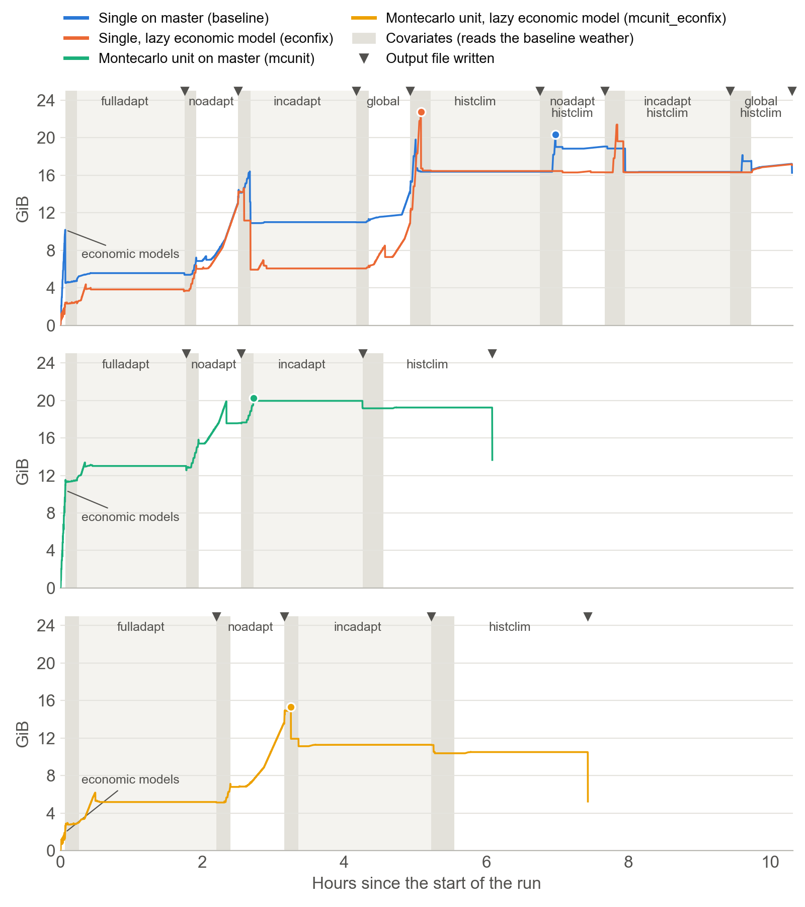
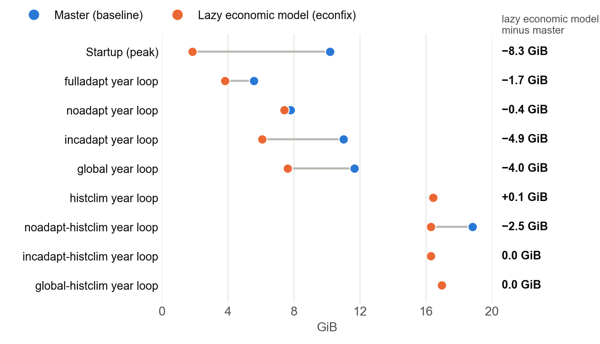
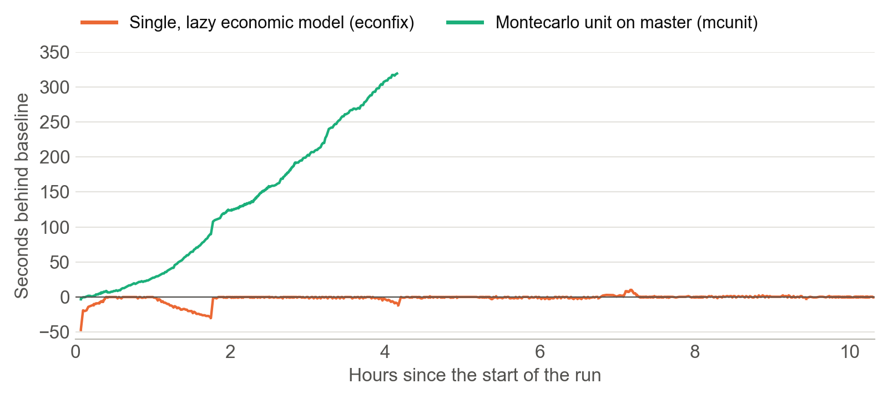

# Memory over a full agriculture run

This experiment measures the memory of the winter wheat projection with all regions, which is what sets the memory a job asks for. It covers a single and one montecarlo unit, each on master and with the [lazy economic model](https://github.com/ClimateImpactLab/impact-calculations/tree/econmodel-memory), profiled on Midway on November 18, 2026.

## Summary

In the single, the lazy economic model did not lower the peak, which was 20.4 GiB on master and 22.9 GiB with the lazy economic model. The difference appears to come from the timing of garbage collection rather than from the change. In the montecarlo unit, which keeps the ten economic models loaded, the lazy economic model lowered the peak from 20.2 to 15.4 GiB.

The single peaked hours into the run, in the covariate step of a histclim variant, not at startup. The runs suggest that this peak is weather data that Python frees only at a full garbage collection, which the [garbage collection runs](../2026-11-agri-memory-gc/README.md) looked at next. On master, the montecarlo unit (4 files) took 6.1 h against 10.3 h for the single (8 files).

## Setup

There are four runs. baseline is the single on master (8 files) and econfix the same single with the lazy economic model. mcunit is montecarlo unit batch 0 on master (4 files, ten economic models), and mcunit_econfix the same unit with the lazy economic model. All four wrote every file.

baseline, econfix and mcunit started at 12:10:47 on the same node (midway3-0430, Intel Xeon Gold 6448Y), with one core each. mcunit_econfix started at 16:54:30 on caslake (midway3-0153, Intel Xeon Gold 6248R), also with one core.

Memory is the RSS of the projection process, sampled every second, in GiB, and the job cgroup stayed within 0.7 GiB of it. Peaks are those of the job cgroup, and tables that also give the process peak label it. Reads are in GB. Each variant has three stages, taken from the log: covariates, calculation setup and the year loop (1981 to 2098), which ends by writing the file.

## Memory over the run

Timelines open in Perfetto and take about 10 seconds to load.

| run | cgroup peak | process peak | time of peak | stage |
|-----|-------------|--------------|--------------|-------|
| baseline | 20.4 GiB | 20.3 GiB | 6.98 h | covariates of noadapt-histclim ([run timeline][p-base]) |
| econfix | 22.9 GiB | 22.8 GiB | 5.08 h | covariates of histclim ([run timeline][p-econfix]) |
| mcunit | 20.2 GiB | 20.2 GiB | 2.72 h | calculation setup of incadapt ([run timeline][p-mcunit]) |
| mcunit_econfix | 15.4 GiB | 15.3 GiB | 3.25 h | covariates of incadapt ([run timeline][p-mcfix]) |

Startup, which loads the ten economic models, peaked at 10.2 GiB on master and 1.8 GiB with the lazy economic model. The covariate step of a histclim variant read 56.6 GB of weather, against 15.5 GB in the other variants, and in the first histclim variant memory rose in steps of about 0.4 GiB, one per weather year.

In these runs, steady growth occurred only in the year loops of noadapt (10 to 12 GiB/h in the singles) and global (3 to 6 GiB/h), while the year loops of fulladapt and incadapt stayed flat. Memory dropped in single steps, often mid-stage, rather than at the end of a stage, and writing the output files had no visible effect on memory.



## Effect of the lazy economic model

| stage | master | lazy economic model |
|-------|--------|--------|
| startup peak | 10.2 GiB | 1.8 GiB |
| fulladapt year loop (median) | 5.6 GiB | 3.8 GiB |
| noadapt year loop | 7.8 GiB | 7.4 GiB |
| incadapt year loop | 11.0 GiB | 6.1 GiB |
| global year loop | 11.7 GiB | 7.6 GiB |
| start of histclim | 14.1 GiB | 10.8 GiB |
| year loops from histclim on | 16.3 to 18.8 GiB | 16.3 to 16.9 GiB |
| montecarlo unit peak (cgroup) | 20.2 GiB | 15.4 GiB |

In the single, the higher peak with the lazy economic model appears to come from when the garbage collection ran, not from the change. The size and timing of each spike varied with it.



## Probable cause of the peak

References are to impact-calculations [`ca9da17`](https://github.com/ClimateImpactLab/impact-calculations/commit/ca9da178378ffbadcb149b9666ddd86c2faa7e02) and [openest 3.1.5.dev16](https://github.com/ClimateImpactLab/open-estimate).

In openest, `FastDataset` and its `FastDataArray` objects reference each other (`openest/generate/fast_dataset.py:38-43, 185`), so they are freed only by a full garbage collection, not when the last reference is dropped. Weather for each year and each region is built from these objects (`generate/weather.py:318, 440, 559`, `fast_dataset.py:300`). A region's arrays are views of the full year (`fast_dataset.py:293, 299`), so one uncollected region keeps the whole year in memory.

A full run keeps millions of long-lived objects, such as the calculations, curves and covariate averages of each region, so Python 3.7 runs a full collection rarely and discarded weather accumulates in between. histclim reads all seven weather variables for each seasonal covariate (`weather.py:404, 437-445`), about 0.4 GiB per year, which matches the size of each step. noadapt and global reuse the 2015 curve of each region (`adaptation/curvegen.py:243-244`), add few new objects and trigger full collections less often, which matches growth only in those two variants. Quick runs with one region pushed the same weather through the same step and rose 0.5 GiB at most.

The code and these runs make other causes unlikely: output arrays (preallocated, about 0.2 GB per file), covariate averages (fixed length), the two-year weather window, the curve cache (one per region) and diagnostics (dropped without a diagnostic file). The garbage collection runs are consistent with this explanation, since with a collection every minute the single peaked at 10.1 GiB, at startup ([garbage collection report](../2026-11-agri-memory-gc/README.md)).


## Other observations

The 34.2 GiB total over all processes in econfix is one sample, 1 s before the end of the run. `generate/generate.py:287` runs `os.system("chmod ...")`, which forks the process, and the sampler counts the shared memory twice. The cgroup read 17.5 GiB at that second.

baseline and econfix ended at the same second after 10.3 h. Both read the same weather files in the same order on one node, and the job in front reads from the file system while the one behind finds the blocks cached, so the two move in step. Their wall times are therefore not independent measures, and the only clean time difference is the lazy economic model's 46 s shorter startup.



## Output checks

| run | reference | files | result |
|-----|-----------|-------|--------|
| econfix | baseline | 8 | all identical ([output check][c-econfix]) |
| mcunit_econfix | mcunit | 4 | 3 identical, histclim differs ([output check][c-mcfix]) |

Master and the lazy economic model gave the same economic model values and the same outputs in eight regions ([same values, step by step][same-nb]).

The histclim file of mcunit_econfix differs because of its year-order seed. `seed-yearorder` is a crc32 hash of batch, RCP, GCM, SSP and IAM (`generate/pvalses.py:246-248`). When the output folder already has a `pvals.yml` without the seed, the fields come in another order (`generate/generate.py:70` against `generate/generate.py:236-240`), which gives a different seed. mcunit_econfix started from mcunit's `pvals.yml`, which held `seed-csvv` but not yet `seed-yearorder`, so its histclim seed differs: 1691349118 against 2357346654 in mcunit.

## Runs

Timelines open in Perfetto and take about 10 seconds to load.

| run | code | wall | cgroup peak | process peak | files |
|-----|------|------|-------------|--------------|-------|
| baseline | master [`ca9da17`](https://github.com/ClimateImpactLab/impact-calculations/commit/ca9da178378ffbadcb149b9666ddd86c2faa7e02) | 10:18:44 | 20.4 GiB | 20.3 GiB at 6.98 h | [run details][m-base], [run timeline][p-base], [stage times][s-base] |
| econfix | branch [`61d2f28`](https://github.com/ClimateImpactLab/impact-calculations/commit/61d2f28af62c52e8431a41c517b486ee23c1f1a2) | 10:18:44 | 22.9 GiB | 22.8 GiB at 5.08 h | [run details][m-econfix], [run timeline][p-econfix], [stage times][s-econfix], [output check][c-econfix] |
| mcunit | master [`ca9da17`](https://github.com/ClimateImpactLab/impact-calculations/commit/ca9da178378ffbadcb149b9666ddd86c2faa7e02) | 6:05:27 | 20.2 GiB | 20.2 GiB at 2.72 h | [run details][m-mcunit], [run timeline][p-mcunit], [stage times][s-mcunit] |
| mcunit_econfix | branch [`61d2f28`](https://github.com/ClimateImpactLab/impact-calculations/commit/61d2f28af62c52e8431a41c517b486ee23c1f1a2) | 7:26:19 (caslake) | 15.4 GiB | 15.3 GiB at 3.25 h | [run details][m-mcfix], [run timeline][p-mcfix], [stage times][s-mcfix], [output check][c-mcfix] |

mcunit_econfix peaked at 15.4 GiB in the cgroup, against 20.2 GiB for mcunit. It ran on caslake, another CPU model, so its wall time is not comparable with the other runs.

## Run

- Configs in this repo: [`baseline.yml`](../../profiling/configs/baseline.yml), [`econfix.yml`](../../profiling/configs/econfix.yml), [`mcunit.yml`](../../profiling/configs/mcunit.yml) and [`mcunit_econfix.yml`](../../profiling/configs/mcunit_econfix.yml) in [`profiling/configs/`](../../profiling/configs/). They import the agriculture base config, copied to [`profiling/configs/base/wheat_winter_pbarspline.yml`](../../profiling/configs/base/wheat_winter_pbarspline.yml).
- Jobs: [`baseline.sbatch`](../../profiling/jobs/baseline.sbatch), [`econfix.sbatch`](../../profiling/jobs/econfix.sbatch), [`mcunit.sbatch`](../../profiling/jobs/mcunit.sbatch), [`mcunit_econfix.sbatch`](../../profiling/jobs/mcunit_econfix.sbatch) and [`check.sbatch`](../../profiling/jobs/check.sbatch) in [`profiling/jobs/`](../../profiling/jobs/), all sourcing [`run_experiment.sh`](../../profiling/jobs/run_experiment.sh). On Midway the same kit runs from `hpc-jobs/agriculture/profiling/`.
- impact-calculations: master at [`ca9da17`](https://github.com/ClimateImpactLab/impact-calculations/commit/ca9da178378ffbadcb149b9666ddd86c2faa7e02) and the branch [`econmodel-memory`](https://github.com/ClimateImpactLab/impact-calculations/tree/econmodel-memory) at [`61d2f28`](https://github.com/ClimateImpactLab/impact-calculations/commit/61d2f28af62c52e8431a41c517b486ee23c1f1a2).
- Figures: `python3 figures/make_figures.py`, from the files in `reports/`.
- From `hpc-jobs/` on Midway:

```bash
IC=/project/cil/home_dirs/scadavidsanchez/repos/impact-calculations
sbatch --export=ALL,IMPACT_CALCULATIONS=$IC agriculture/profiling/jobs/baseline.sbatch
sbatch agriculture/profiling/jobs/econfix.sbatch
MC=$(sbatch --parsable --export=ALL,IMPACT_CALCULATIONS=$IC agriculture/profiling/jobs/mcunit.sbatch)
sbatch --dependency=afterok:$MC agriculture/profiling/jobs/mcunit_econfix.sbatch
sbatch agriculture/profiling/jobs/check.sbatch    # output checks, once all have ended
```

## Data

- `/scratch/midway3/cadavidsanchez/agri-profiling/<run>/`: outputs and raw samples. Scratch is purged periodically.
- `/project/cil/home_dirs/scadavidsanchez/projects/socioeconomics-update/checks/agriculture/profiling-full/`: 1 s samples, run logs, Slurm logs, output file times and sacct.

[p-base]: https://c1587s.github.io/impact-calculations-experiments/perfetto.html?trace=experiments/2026-11-agri-memory-full/reports/baseline/trace.json
[m-base]: https://c1587s.github.io/impact-calculations-experiments/experiments/2026-11-agri-memory-full/reports/baseline/manifest.json
[s-base]: https://github.com/C1587S/impact-calculations-experiments/blob/main/experiments/2026-11-agri-memory-full/reports/baseline/markers.tsv
[p-econfix]: https://c1587s.github.io/impact-calculations-experiments/perfetto.html?trace=experiments/2026-11-agri-memory-full/reports/econfix/trace.json
[m-econfix]: https://c1587s.github.io/impact-calculations-experiments/experiments/2026-11-agri-memory-full/reports/econfix/manifest.json
[s-econfix]: https://github.com/C1587S/impact-calculations-experiments/blob/main/experiments/2026-11-agri-memory-full/reports/econfix/markers.tsv
[p-mcunit]: https://c1587s.github.io/impact-calculations-experiments/perfetto.html?trace=experiments/2026-11-agri-memory-full/reports/mcunit/trace.json
[m-mcunit]: https://c1587s.github.io/impact-calculations-experiments/experiments/2026-11-agri-memory-full/reports/mcunit/manifest.json
[s-mcunit]: https://github.com/C1587S/impact-calculations-experiments/blob/main/experiments/2026-11-agri-memory-full/reports/mcunit/markers.tsv
[c-econfix]: https://c1587s.github.io/impact-calculations-experiments/experiments/2026-11-agri-memory-full/reports/econfix/check.json
[p-mcfix]: https://c1587s.github.io/impact-calculations-experiments/perfetto.html?trace=experiments/2026-11-agri-memory-full/reports/mcunit_econfix/trace.json
[m-mcfix]: https://c1587s.github.io/impact-calculations-experiments/experiments/2026-11-agri-memory-full/reports/mcunit_econfix/manifest.json
[s-mcfix]: https://github.com/C1587S/impact-calculations-experiments/blob/main/experiments/2026-11-agri-memory-full/reports/mcunit_econfix/markers.tsv
[c-mcfix]: https://c1587s.github.io/impact-calculations-experiments/experiments/2026-11-agri-memory-full/reports/mcunit_econfix/check.json
[same-nb]: https://c1587s.github.io/impact-calculations-experiments/experiments/2026-11-agri-memory-full/same_outputs.html
