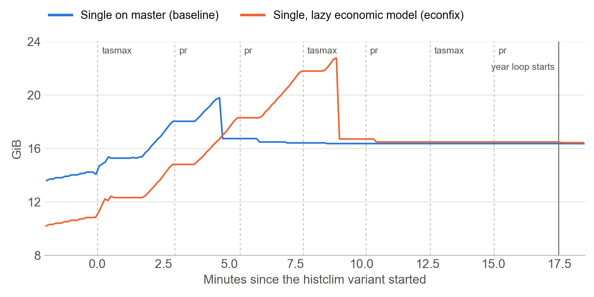

# Memory over a full agriculture run

The winter wheat single and one montecarlo unit with all regions, each on master and with the lazy econ model, run on Midway on November 18, 2026.

## Summary

In the single, the lazy econ model did not lower the peak, 20.4 GiB on master against 22.9 GiB, a difference that appears to come from the timing of garbage collection. In the montecarlo unit, which keeps the ten economic models loaded, it lowered the peak from 20.2 to 15.4 GiB.

The single peaked hours into the run, in the covariates of a histclim variant, not at startup. This peak appears to be weather data that Python frees only at a full garbage collection, tested next in the [gc](../2026-11-agri-memory-gc/README.md) round. On master, the montecarlo unit (4 files) took 6.1 h against 10.3 h for the single (8 files).

## Setup

baseline is the single on master and econfix the same single with the lazy econ model. mcunit is montecarlo unit batch 0 on master, and mcunit_econfix the same unit with the lazy econ model. All four wrote every file. Master is [`ca9da17`](https://github.com/ClimateImpactLab/impact-calculations/commit/ca9da178378ffbadcb149b9666ddd86c2faa7e02). Lazy econ model is [`econmodel-memory`](https://github.com/ClimateImpactLab/impact-calculations/tree/econmodel-memory) at [`61d2f28`](https://github.com/ClimateImpactLab/impact-calculations/commit/61d2f28af62c52e8431a41c517b486ee23c1f1a2).

baseline, econfix and mcunit ran on cil and mcunit_econfix on caslake, so its wall time does not compare with the others.

Peaks are cgroup peaks, and the cgroup stayed within 0.7 GiB of the process RSS.

## Memory over the run

| run | code | cgroup peak | process peak | stage of the peak | timeline |
|-----|------|-------------|--------------|-------------------|----------|
| baseline | master | 20.4 GiB | 20.3 GiB at 6.98 h | covariates of noadapt-histclim | [timeline][p-base] |
| econfix | lazy econ model | 22.9 GiB | 22.8 GiB at 5.08 h | covariates of histclim | [timeline][p-econfix] |
| mcunit | master | 20.2 GiB | 20.2 GiB at 2.72 h | calculation setup of incadapt | [timeline][p-mcunit] |
| mcunit_econfix | lazy econ model | 15.4 GiB | 15.3 GiB at 3.25 h | covariates of incadapt | [timeline][p-mcfix] |

Startup peaked at 10.2 GiB on master and 1.8 GiB with the lazy econ model. The covariates of a histclim variant read 56.6 GB of weather, against 15.5 GB in the other variants, and in the first histclim variant memory rose in steps of about 0.4 GiB, one per weather year.

Memory grew steadily in the year loops of noadapt (10 to 12 GiB/h in the singles) and global (3 to 6 GiB/h), and stayed flat in those of fulladapt and incadapt. It dropped in single steps, often mid-stage rather than at the end of a stage, and writing the output files had no visible effect on memory.


## Probable cause of the peak

References are to impact-calculations [`ca9da17`](https://github.com/ClimateImpactLab/impact-calculations/commit/ca9da178378ffbadcb149b9666ddd86c2faa7e02) and [openest 3.1.5.dev16](https://github.com/ClimateImpactLab/open-estimate).

In openest, `FastDataset` and its `FastDataArray` objects reference each other (`openest/generate/fast_dataset.py:38-43, 185`), so they are freed at a full garbage collection, not when the last reference is dropped. Weather for each year and each region is built from these objects (`generate/weather.py:318, 440, 559`, `fast_dataset.py:300`). A region's arrays are views of the full year (`fast_dataset.py:293, 299`), so one uncollected region keeps the whole year in memory.

A full run keeps millions of long-lived objects, such as the calculations, curves and covariate averages of each region, so Python 3.7 runs a full collection rarely and discarded weather accumulates in between. histclim reads all seven weather variables for each seasonal covariate (`weather.py:404, 437-445`), about 0.4 GiB per year, the size of each step. noadapt and global reuse the 2015 curve of each region (`adaptation/curvegen.py:243-244`), add few new objects and trigger full collections less often, which matches the growth in those two variants. Quick runs with one region pushed the same weather through the same step and rose 0.5 GiB at most.

The code and these runs make other causes unlikely: output arrays (preallocated, about 0.2 GB per file), covariate averages (fixed length), the two-year weather window, the curve cache (one per region) and diagnostics (dropped without a diagnostic file). With a collection every minute the single peaked at 10.1 GiB, at startup, in the [gc](../2026-11-agri-memory-gc/README.md) round.



## Other observations

The 34.2 GiB total over all processes in econfix is one sample, 1 s before the end, when `os.system("chmod ...")` at `generate/generate.py:287` forks the process and the sampler counts shared memory twice, while the cgroup read 17.5 GiB.

baseline and econfix ended at the same second after 10.3 h, reading the same weather in step on one node, so their wall times are not independent measures apart from the 46 s shorter startup with the lazy econ model.


## Output checks

| run | reference | files | identical | largest difference | result |
|-----|-----------|-------|-----------|--------------------|--------|
| econfix | agriculture/wheat_winter/single/rcp85/CCSM4/high/SSP3 | 8 | 2 | 7.5e-09 | [pass][c-econfix] |
| mcunit_econfix | master, job 63433857 | 4 | 3 | 3.6e+03 | [fail][c-mcfix], histclim |

Paths are under `/project/cil/gcp/outputs_newsocioeconomics/`. Pass means every variable is within rtol 1e-5 and atol 1e-8. The small differences in econfix come from master and the lazy econ model running on different CPU types.

Master and the lazy econ model gave the same economic model values and the same outputs in eight regions ([notebook][same-nb]).

The histclim file of mcunit_econfix differs because it started from mcunit's `pvals.yml` without `seed-yearorder`, so the crc32 hash of batch, RCP, GCM, SSP and IAM (`generate/pvalses.py:246-248`) took the fields in another order (`generate/generate.py:70` against `generate/generate.py:236-240`) and gave seed 1691349118 against 2357346654 in mcunit.

## Runs

| run | code | wall | cgroup peak | process peak | files |
|-----|------|------|-------------|--------------|-------|
| baseline | master [`ca9da17`](https://github.com/ClimateImpactLab/impact-calculations/commit/ca9da178378ffbadcb149b9666ddd86c2faa7e02) | 10:18:44 | 20.4 GiB | 20.3 GiB at 6.98 h | [details][m-base], [timeline][p-base], [stages][s-base] |
| econfix | lazy econ model [`61d2f28`](https://github.com/ClimateImpactLab/impact-calculations/commit/61d2f28af62c52e8431a41c517b486ee23c1f1a2) | 10:18:44 | 22.9 GiB | 22.8 GiB at 5.08 h | [details][m-econfix], [timeline][p-econfix], [stages][s-econfix], [check][c-econfix] |
| mcunit | master [`ca9da17`](https://github.com/ClimateImpactLab/impact-calculations/commit/ca9da178378ffbadcb149b9666ddd86c2faa7e02) | 6:05:27 | 20.2 GiB | 20.2 GiB at 2.72 h | [details][m-mcunit], [timeline][p-mcunit], [stages][s-mcunit] |
| mcunit_econfix | lazy econ model [`61d2f28`](https://github.com/ClimateImpactLab/impact-calculations/commit/61d2f28af62c52e8431a41c517b486ee23c1f1a2) | 7:26:19 (caslake) | 15.4 GiB | 15.3 GiB at 3.25 h | [details][m-mcfix], [timeline][p-mcfix], [stages][s-mcfix], [check][c-mcfix] |

## Run

- Configs: [`baseline.yml`](../../profiling/configs/baseline.yml), [`econfix.yml`](../../profiling/configs/econfix.yml), [`mcunit.yml`](../../profiling/configs/mcunit.yml) and [`mcunit_econfix.yml`](../../profiling/configs/mcunit_econfix.yml) in [`profiling/configs/`](../../profiling/configs/). They import the agriculture base config, copied to [`profiling/configs/base/wheat_winter_pbarspline.yml`](../../profiling/configs/base/wheat_winter_pbarspline.yml).
- Jobs: [`baseline.sbatch`](../../profiling/jobs/baseline.sbatch), [`econfix.sbatch`](../../profiling/jobs/econfix.sbatch), [`mcunit.sbatch`](../../profiling/jobs/mcunit.sbatch), [`mcunit_econfix.sbatch`](../../profiling/jobs/mcunit_econfix.sbatch) and [`check.sbatch`](../../profiling/jobs/check.sbatch) in [`profiling/jobs/`](../../profiling/jobs/), all sourcing [`run_experiment.sh`](../../profiling/jobs/run_experiment.sh). On Midway the kit runs from `hpc-jobs/agriculture/profiling/`.
- Figures: `python3 figures/make_figures.py`, from the files in `reports/`.
- From `hpc-jobs/` on Midway:

```bash
IC=/project/cil/home_dirs/scadavidsanchez/repos/impact-calculations
sbatch --export=ALL,IMPACT_CALCULATIONS=$IC agriculture/profiling/jobs/baseline.sbatch
sbatch agriculture/profiling/jobs/econfix.sbatch
MC=$(sbatch --parsable --export=ALL,IMPACT_CALCULATIONS=$IC agriculture/profiling/jobs/mcunit.sbatch)
sbatch --dependency=afterok:$MC agriculture/profiling/jobs/mcunit_econfix.sbatch
sbatch agriculture/profiling/jobs/check.sbatch    # output checks, once all have ended
```

## Data

- `/scratch/midway3/cadavidsanchez/agri-profiling/<run>/`: outputs and raw samples.
- `/project/cil/home_dirs/scadavidsanchez/projects/socioeconomics-update/checks/agriculture/profiling-full/`: 1 s samples, run logs, Slurm logs, output file times and sacct.

[p-base]: https://c1587s.github.io/impact-calculations-experiments/perfetto.html?trace=experiments/2026-11-agri-memory-full/reports/baseline/trace.json
[m-base]: https://c1587s.github.io/impact-calculations-experiments/experiments/2026-11-agri-memory-full/reports/baseline/manifest.json
[s-base]: https://github.com/C1587S/impact-calculations-experiments/blob/main/experiments/2026-11-agri-memory-full/reports/baseline/markers.tsv
[p-econfix]: https://c1587s.github.io/impact-calculations-experiments/perfetto.html?trace=experiments/2026-11-agri-memory-full/reports/econfix/trace.json
[m-econfix]: https://c1587s.github.io/impact-calculations-experiments/experiments/2026-11-agri-memory-full/reports/econfix/manifest.json
[s-econfix]: https://github.com/C1587S/impact-calculations-experiments/blob/main/experiments/2026-11-agri-memory-full/reports/econfix/markers.tsv
[p-mcunit]: https://c1587s.github.io/impact-calculations-experiments/perfetto.html?trace=experiments/2026-11-agri-memory-full/reports/mcunit/trace.json
[m-mcunit]: https://c1587s.github.io/impact-calculations-experiments/experiments/2026-11-agri-memory-full/reports/mcunit/manifest.json
[s-mcunit]: https://github.com/C1587S/impact-calculations-experiments/blob/main/experiments/2026-11-agri-memory-full/reports/mcunit/markers.tsv
[c-econfix]: https://c1587s.github.io/impact-calculations-experiments/experiments/2026-11-agri-memory-full/reports/econfix/check.json
[p-mcfix]: https://c1587s.github.io/impact-calculations-experiments/perfetto.html?trace=experiments/2026-11-agri-memory-full/reports/mcunit_econfix/trace.json
[m-mcfix]: https://c1587s.github.io/impact-calculations-experiments/experiments/2026-11-agri-memory-full/reports/mcunit_econfix/manifest.json
[s-mcfix]: https://github.com/C1587S/impact-calculations-experiments/blob/main/experiments/2026-11-agri-memory-full/reports/mcunit_econfix/markers.tsv
[c-mcfix]: https://c1587s.github.io/impact-calculations-experiments/experiments/2026-11-agri-memory-full/reports/mcunit_econfix/check.json
[same-nb]: https://c1587s.github.io/impact-calculations-experiments/experiments/2026-11-agri-memory-full/same_outputs.html
