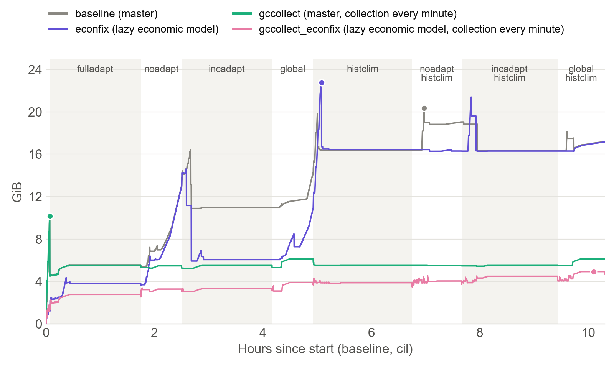

# Garbage collection in full agriculture runs

The full winter wheat single with a full garbage collection every minute, on master and with the lazy econ model, and the montecarlo unit with lazy + gc, run on Midway on November 19, 2026. The runs test whether the peak of the full runs is memory that waits for Python's collector, against the [full](../2026-11-agri-memory-full/README.md) round of November 18.

## Summary

A full garbage collection every minute lowered the cgroup peak of the single from 20.4 to 10.1 GiB on master and from 22.9 to 5.3 GiB with the lazy econ model, and outputs passed the check against master. In the montecarlo unit, lazy + gc peaked at 5.0 GiB, against 15.4 GiB with the lazy econ model and 20.2 GiB on master, and its files were identical to those of mcunit.

Master + gc peaked at startup, while loading the ten economic models, and stayed at or below 6.3 GiB afterwards. Lazy + gc stayed at or below 5.3 GiB throughout in the single and 5.0 GiB in the montecarlo unit. The covariates of histclim, where the full singles peaked, stayed below 6 GiB, against about 20 GiB without the collections. This is consistent with the probable cause in the [full](../2026-11-agri-memory-full/README.md) round, weather data that waits for a full collection.

Collections took 22.7 and 24.7 min in the singles and 17.2 min in the montecarlo unit, 3.0%, 3.4% and 3.8% of the run, about 2 s each.

## Setup

baseline (master) and econfix (lazy econ model) are the full singles of the [full](../2026-11-agri-memory-full/README.md) round, run on cil. gccollect (master + gc) and gccollect_econfix (lazy + gc) are the same singles with `gc.collect()` every 60 s in the main thread, through the kit's `gc_capture.py`, with impact-calculations and openest unchanged. Master is [`d642a03`](https://github.com/ClimateImpactLab/impact-calculations/commit/d642a03b02b0b5b81604fbc3355d406919c82e39), `ca9da17` with the additional SSPs, which every run used. Lazy econ model is [`e033e7b`](https://github.com/ClimateImpactLab/impact-calculations/commit/e033e7b9bd00ee94a575d2c4ce328add4d2dd827), one commit on top. Both are on [`econmodel-memory`](https://github.com/ClimateImpactLab/impact-calculations/tree/econmodel-memory).

mcunit (master) and mcunit_econfix (lazy econ model) are the montecarlo units of the full round, batch 0, and mcunit_gccollect_econfix (lazy + gc) is mcunit_econfix with the same collections. mcunit_gccollect_econfix started from mcunit's `pvals.yml` with both seeds, so it drew the same coefficients and histclim year order as mcunit.

Peaks in the text are cgroup peaks, which include page cache.

## Results

| run | code | partition | wall | cgroup peak | process peak | stage of the peak |
|-----|------|-----------|------|-------------|--------------|-------------------|
| baseline | master | cil | 10:18:44 | 20.4 GiB | 20.3 GiB at 6.98 h | covariates of noadapt-histclim |
| econfix | lazy econ model | cil | 10:18:44 | 22.9 GiB | 22.8 GiB at 5.08 h | covariates of histclim |
| gccollect | master + gc | caslake | 12:35:51 | 10.1 GiB | 10.2 GiB at 0.07 h | startup, loading the economic models |
| gccollect_econfix | lazy + gc | caslake | 12:13:20 | 5.3 GiB | 4.9 GiB at 11.98 h | year loop of global-histclim |
| mcunit | master | cil | 6:05:27 | 20.2 GiB | 20.2 GiB at 2.72 h | calculation setup of incadapt |
| mcunit_econfix | lazy econ model | caslake | 7:26:20 | 15.4 GiB | 15.3 GiB at 3.25 h | covariates of incadapt |
| mcunit_gccollect_econfix | lazy + gc | caslake | 7:32:34 | 5.0 GiB | 4.9 GiB at 5.53 h | covariates of histclim |


## Memory over the run

| process memory by stage | baseline | econfix | gccollect | gccollect_econfix |
|-------------------------|----------|---------|-----------|-------------------|
| startup peak | 10.2 GiB | 1.8 GiB | 10.2 GiB | 1.8 GiB |
| year loops of the first four variants (median) | 5.6 to 11.7 GiB | 3.8 to 7.6 GiB | 5.5 to 6.1 GiB | 2.8 to 3.9 GiB |
| covariates of histclim (highest) | 19.8 GiB | 22.8 GiB | 5.8 GiB | 4.3 GiB |
| year loops from histclim on (median) | 16.3 to 18.8 GiB | 16.3 to 16.9 GiB | 5.5 to 6.1 GiB | 3.9 to 4.9 GiB |

With a collection every minute, memory no longer grew within a year loop, and noadapt and global reached 5.5 and 6.1 GiB with master + gc, against 13.0 and 14.2 GiB in baseline. The startup peak stayed at 10.2 GiB on master and 1.8 GiB with the lazy econ model, so with master + gc it became the peak of the run.

Lazy + gc stayed 1.1 to 2.8 GiB below master + gc in every year loop, rising from 2.8 GiB in the fulladapt year loop to 4.9 GiB in global-histclim, while master + gc stayed between 5.5 and 6.1 GiB.



| process memory by stage | mcunit | mcunit_econfix | mcunit_gccollect_econfix |
|-------------------------|--------|----------------|--------------------------|
| startup peak | 10.4 GiB | 1.9 GiB | 1.9 GiB |
| year loops of fulladapt, noadapt and incadapt (median) | 13.0 to 19.9 GiB | 5.2 to 11.3 GiB | 3.4 to 4.0 GiB |
| covariates of incadapt (highest) | 20.2 GiB | 15.3 GiB | 4.2 GiB |
| covariates of histclim (highest) | 19.2 GiB | 11.3 GiB | 4.9 GiB |
| year loop of histclim (median) | 19.2 GiB | 10.5 GiB | 4.9 GiB |

The montecarlo unit appears to behave like the single. With the collections, memory no longer grew within a year loop, and the noadapt year loop stayed at 3.9 GiB against up to 13.6 GiB in mcunit_econfix. The covariates of incadapt, where mcunit_econfix peaked at 15.3 GiB, reached 4.2 GiB, and the run peaked in the covariates of histclim instead, at 4.9 GiB. The startup peak stayed at 1.9 GiB.


## Time cost of garbage collection

| run | collections | total | share of the run | median | longest |
|-----|-------------|-------|------------------|--------|---------|
| gccollect | 755 | 22.7 min | 3.0% | 2.0 s | 2.8 s, year loop of histclim |
| gccollect_econfix | 732 | 24.7 min | 3.4% | 1.9 s | 4.0 s, calculation setup of global |
| mcunit_gccollect_econfix | 451 | 17.2 min | 3.8% | 2.3 s | 4.0 s, year loop of fulladapt |

The collections freed 8.1 million objects in gccollect, 11.3 million in gccollect_econfix and 4.7 million in mcunit_gccollect_econfix, up to 1.2, 2.1 and 2.1 million in one collection.

| run | wall | against | its wall | ratio |
|-----|------|---------|----------|-------|
| gccollect | 12:35:51 (caslake) | baseline | 10:18:44 (cil) | 1.22 |
| gccollect_econfix | 12:13:20 (caslake) | econfix | 10:18:44 (cil) | 1.19 |
| mcunit_gccollect_econfix | 7:32:34 (caslake) | mcunit_econfix | 7:26:20 (caslake) | 1.01 |

Wall time appears to vary between nodes about as much as the collections cost, so it cannot isolate their cost, and the totals above come from `gc.csv`.

## Output checks

| run | reference | files | identical | largest difference | result |
|-----|-----------|-------|-----------|--------------------|--------|
| gccollect | agriculture/wheat_winter/single/rcp85/CCSM4/high/SSP3 | 8 | 2 | 7.5e-09 | [pass][c-gc] |
| gccollect_econfix | agriculture/wheat_winter/single/rcp85/CCSM4/high/SSP3 | 8 | 2 | 7.5e-09 | [pass][c-gcfix] |
| mcunit_gccollect_econfix | master, job 63433857 | 4 | 4 | 0 | [pass][c-mcgcfix] |

Paths are under `/project/cil/gcp/outputs_newsocioeconomics/`. Pass means every variable is within rtol 1e-5 and atol 1e-8. The small differences in gccollect and gccollect_econfix come from master and the gc runs running on different CPU types. mcunit_gccollect_econfix used mcunit's complete `pvals.yml`, so its histclim file also matched, unlike mcunit_econfix in the [full](../2026-11-agri-memory-full/README.md) round.

## Runs

| run | code | wall | cgroup peak | process peak | files |
|-----|------|------|-------------|--------------|-------|
| baseline | master [`d642a03`](https://github.com/ClimateImpactLab/impact-calculations/commit/d642a03b02b0b5b81604fbc3355d406919c82e39) | 10:18:44 | 20.4 GiB | 20.3 GiB at 6.98 h | [details][m-base], [timeline][p-base], [stages][s-base] |
| econfix | lazy econ model [`e033e7b`](https://github.com/ClimateImpactLab/impact-calculations/commit/e033e7b9bd00ee94a575d2c4ce328add4d2dd827) | 10:18:44 | 22.9 GiB | 22.8 GiB at 5.08 h | [details][m-econfix], [timeline][p-econfix], [stages][s-econfix], [check][c-econfix] |
| gccollect | master + gc [`d642a03`](https://github.com/ClimateImpactLab/impact-calculations/commit/d642a03b02b0b5b81604fbc3355d406919c82e39) | 12:35:51 (caslake) | 10.1 GiB | 10.2 GiB at 0.07 h | [details][m-gc], [timeline][p-gc], [stages][s-gc], [check][c-gc], [collections][g-gc] |
| gccollect_econfix | lazy + gc [`e033e7b`](https://github.com/ClimateImpactLab/impact-calculations/commit/e033e7b9bd00ee94a575d2c4ce328add4d2dd827) | 12:13:20 (caslake) | 5.3 GiB | 4.9 GiB at 11.98 h | [details][m-gcfix], [timeline][p-gcfix], [stages][s-gcfix], [check][c-gcfix], [collections][g-gcfix] |
| mcunit | master [`d642a03`](https://github.com/ClimateImpactLab/impact-calculations/commit/d642a03b02b0b5b81604fbc3355d406919c82e39) | 6:05:27 | 20.2 GiB | 20.2 GiB at 2.72 h | [details][m-mcunit], [timeline][p-mcunit], [stages][s-mcunit] |
| mcunit_econfix | lazy econ model [`e033e7b`](https://github.com/ClimateImpactLab/impact-calculations/commit/e033e7b9bd00ee94a575d2c4ce328add4d2dd827) | 7:26:20 (caslake) | 15.4 GiB | 15.3 GiB at 3.25 h | [details][m-mcfix], [timeline][p-mcfix], [stages][s-mcfix], [check][c-mcfix] |
| mcunit_gccollect_econfix | lazy + gc [`e033e7b`](https://github.com/ClimateImpactLab/impact-calculations/commit/e033e7b9bd00ee94a575d2c4ce328add4d2dd827) | 7:32:34 (caslake) | 5.0 GiB | 4.9 GiB at 5.53 h | [details][m-mcgcfix], [timeline][p-mcgcfix], [stages][s-mcgcfix], [check][c-mcgcfix], [collections][g-mcgcfix] |

## Run

- Configs: [`gccollect.yml`](../../profiling/configs/gccollect.yml) and [`gccollect_econfix.yml`](../../profiling/configs/gccollect_econfix.yml), with the settings of baseline, and [`mcunit_gccollect_econfix.yml`](../../profiling/configs/mcunit_gccollect_econfix.yml), with the settings of mcunit, in [`profiling/configs/`](../../profiling/configs/). They import the agriculture base config, copied to [`profiling/configs/base/wheat_winter_pbarspline.yml`](../../profiling/configs/base/wheat_winter_pbarspline.yml).
- Jobs: [`gccollect.sbatch`](../../profiling/jobs/gccollect.sbatch), [`gccollect_econfix.sbatch`](../../profiling/jobs/gccollect_econfix.sbatch) and [`mcunit_gccollect_econfix.sbatch`](../../profiling/jobs/mcunit_gccollect_econfix.sbatch) in [`profiling/jobs/`](../../profiling/jobs/), through [`profiling/tools/gc_capture.py`](../../profiling/tools/gc_capture.py) with `--interval 60`. On Midway the kit runs from `hpc-jobs/agriculture/profiling/`.
- mcunit_gccollect_econfix copies mcunit's `pvals.yml` before the projection and stops if it lacks `seed-csvv` or `seed-yearorder`.
- Figures: `python3 figures/make_figures.py`, from the files in `reports/` here and in the full round's `reports/`.
- From `hpc-jobs/` on Midway:

```bash
IC=/project/cil/home_dirs/scadavidsanchez/repos/impact-calculations
G=$(sbatch --parsable --export=ALL,IMPACT_CALCULATIONS=$IC agriculture/profiling/jobs/gccollect.sbatch)
sbatch --dependency=after:$G+30 agriculture/profiling/jobs/gccollect_econfix.sbatch
sbatch agriculture/profiling/jobs/mcunit_gccollect_econfix.sbatch
```

## Data

- `/scratch/midway3/cadavidsanchez/agri-profiling/<run>/`: outputs and raw samples.
- `/project/cil/home_dirs/scadavidsanchez/projects/socioeconomics-update/checks/agriculture/profiling-full/`: 1 s samples, run logs, collection logs, Slurm logs, output file times, `pvals.yml` of mcunit_gccollect_econfix and sacct (`sacct-gc.txt`, `sacct_all.csv`).

[p-base]: https://c1587s.github.io/impact-calculations-experiments/perfetto.html?trace=experiments/2026-11-agri-memory-full/reports/baseline/trace.json
[m-base]: https://c1587s.github.io/impact-calculations-experiments/experiments/2026-11-agri-memory-full/reports/baseline/manifest.json
[s-base]: https://github.com/C1587S/impact-calculations-experiments/blob/main/experiments/2026-11-agri-memory-full/reports/baseline/markers.tsv
[p-econfix]: https://c1587s.github.io/impact-calculations-experiments/perfetto.html?trace=experiments/2026-11-agri-memory-full/reports/econfix/trace.json
[m-econfix]: https://c1587s.github.io/impact-calculations-experiments/experiments/2026-11-agri-memory-full/reports/econfix/manifest.json
[s-econfix]: https://github.com/C1587S/impact-calculations-experiments/blob/main/experiments/2026-11-agri-memory-full/reports/econfix/markers.tsv
[c-econfix]: https://c1587s.github.io/impact-calculations-experiments/experiments/2026-11-agri-memory-full/reports/econfix/check.json
[p-gc]: https://c1587s.github.io/impact-calculations-experiments/perfetto.html?trace=experiments/2026-11-agri-memory-gc/reports/gccollect/trace.json
[m-gc]: https://c1587s.github.io/impact-calculations-experiments/experiments/2026-11-agri-memory-gc/reports/gccollect/manifest.json
[s-gc]: https://github.com/C1587S/impact-calculations-experiments/blob/main/experiments/2026-11-agri-memory-gc/reports/gccollect/markers.tsv
[c-gc]: https://c1587s.github.io/impact-calculations-experiments/experiments/2026-11-agri-memory-gc/reports/gccollect/check.json
[g-gc]: https://github.com/C1587S/impact-calculations-experiments/blob/main/experiments/2026-11-agri-memory-gc/reports/gccollect/gc.csv
[p-gcfix]: https://c1587s.github.io/impact-calculations-experiments/perfetto.html?trace=experiments/2026-11-agri-memory-gc/reports/gccollect_econfix/trace.json
[m-gcfix]: https://c1587s.github.io/impact-calculations-experiments/experiments/2026-11-agri-memory-gc/reports/gccollect_econfix/manifest.json
[s-gcfix]: https://github.com/C1587S/impact-calculations-experiments/blob/main/experiments/2026-11-agri-memory-gc/reports/gccollect_econfix/markers.tsv
[c-gcfix]: https://c1587s.github.io/impact-calculations-experiments/experiments/2026-11-agri-memory-gc/reports/gccollect_econfix/check.json
[g-gcfix]: https://github.com/C1587S/impact-calculations-experiments/blob/main/experiments/2026-11-agri-memory-gc/reports/gccollect_econfix/gc.csv
[p-mcunit]: https://c1587s.github.io/impact-calculations-experiments/perfetto.html?trace=experiments/2026-11-agri-memory-full/reports/mcunit/trace.json
[m-mcunit]: https://c1587s.github.io/impact-calculations-experiments/experiments/2026-11-agri-memory-full/reports/mcunit/manifest.json
[s-mcunit]: https://github.com/C1587S/impact-calculations-experiments/blob/main/experiments/2026-11-agri-memory-full/reports/mcunit/markers.tsv
[p-mcfix]: https://c1587s.github.io/impact-calculations-experiments/perfetto.html?trace=experiments/2026-11-agri-memory-full/reports/mcunit_econfix/trace.json
[m-mcfix]: https://c1587s.github.io/impact-calculations-experiments/experiments/2026-11-agri-memory-full/reports/mcunit_econfix/manifest.json
[s-mcfix]: https://github.com/C1587S/impact-calculations-experiments/blob/main/experiments/2026-11-agri-memory-full/reports/mcunit_econfix/markers.tsv
[c-mcfix]: https://c1587s.github.io/impact-calculations-experiments/experiments/2026-11-agri-memory-full/reports/mcunit_econfix/check.json
[p-mcgcfix]: https://c1587s.github.io/impact-calculations-experiments/perfetto.html?trace=experiments/2026-11-agri-memory-gc/reports/mcunit_gccollect_econfix/trace.json
[m-mcgcfix]: https://c1587s.github.io/impact-calculations-experiments/experiments/2026-11-agri-memory-gc/reports/mcunit_gccollect_econfix/manifest.json
[s-mcgcfix]: https://github.com/C1587S/impact-calculations-experiments/blob/main/experiments/2026-11-agri-memory-gc/reports/mcunit_gccollect_econfix/markers.tsv
[c-mcgcfix]: https://c1587s.github.io/impact-calculations-experiments/experiments/2026-11-agri-memory-gc/reports/mcunit_gccollect_econfix/check.json
[g-mcgcfix]: https://github.com/C1587S/impact-calculations-experiments/blob/main/experiments/2026-11-agri-memory-gc/reports/mcunit_gccollect_econfix/gc.csv
