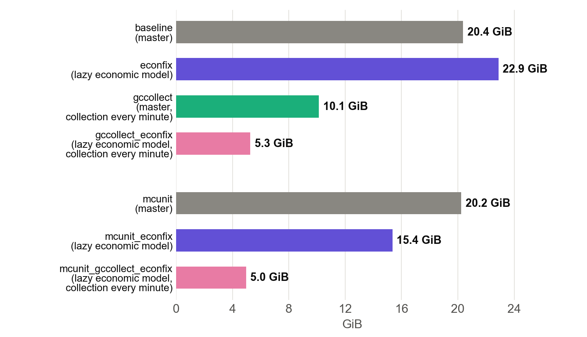
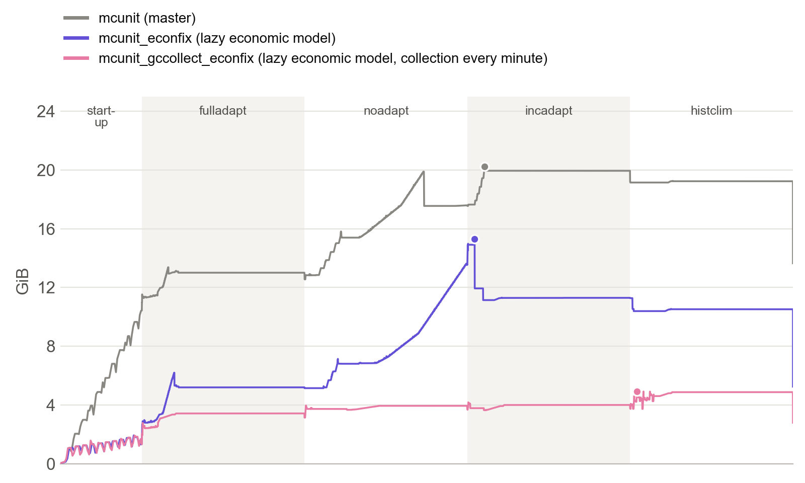

# Garbage collection in full agriculture runs

This experiment repeats the full winter wheat single, all regions, with a full garbage collection every minute, on master and with the [lazy economic model](https://github.com/ClimateImpactLab/impact-calculations/tree/econmodel-memory), and the montecarlo unit with the lazy economic model. It tests whether the peak of the full runs is memory that waits for Python's collector. The runs were profiled on Midway on November 19, 2026, and are compared with the full runs of November 18.

## Summary

In these runs, a full garbage collection every minute lowered the peak of the single from 20.4 to 10.1 GiB on master and from 22.9 to 5.3 GiB with the lazy economic model, and the outputs were identical. In the montecarlo unit with the lazy economic model, the collections lowered the peak from 15.4 to 5.0 GiB, against 20.2 GiB on master, and the four files were identical to those of mcunit. These are job cgroup peaks.

With the collections, master peaked at startup, while loading the ten economic models, and stayed at or below 6.3 GiB afterwards. With the lazy economic model the single stayed at or below 5.3 GiB throughout, and the montecarlo unit at or below 5.0 GiB. The covariates of histclim, where the full singles peaked, stayed below 6 GiB, against about 20 GiB without the collections. This is consistent with the probable cause in the [full-run report](../2026-11-agri-memory-full/README.md), weather data that waits for a full collection.

The collections took 22.7 and 24.7 min in the singles and 17.2 min in the montecarlo unit, 3.0%, 3.4% and 3.8% of the run, about 2 s each. The singles with collections ran on caslake, and their wall times were 1.22 and 1.19 times those of baseline and econfix on cil, at or below the caslake CPU factor of 1.22. The montecarlo unit took 7:32:33 on caslake, 6.2 min more than mcunit_econfix on the same CPU model.

## Setup

baseline (master) and econfix (lazy economic model) are the full singles of the [full-run report](../2026-11-agri-memory-full/README.md), run on cil. gccollect (master) and gccollect_econfix (lazy economic model) are the same singles with a full garbage collection (`gc.collect()`) every 60 s in the projection's main thread, run through the kit's `gc_capture.py`. impact-calculations and openest are unchanged. The lazy economic model builds the age shares on first use and keeps population as one array.

gccollect started at 00:21:06 on caslake (midway3-0153, Intel Xeon Gold 6248R). gccollect_econfix started 30 min later, at 00:51:11, on caslake (midway3-0091, same CPU model), so the two never read the weather in step. Each had one core and 32 GB, and all four runs wrote every file.

mcunit (master) and mcunit_econfix (lazy economic model) are the montecarlo units of the full-run report, batch 0 with four files and the ten economic models kept loaded. mcunit ran on cil and mcunit_econfix on caslake. mcunit_gccollect_econfix is mcunit_econfix with a full garbage collection every 60 s, through the same `gc_capture.py`. Before the projection, the job copied mcunit's `pvals.yml` with both seeds (`seed-csvv` and `seed-yearorder`), so it drew the same coefficients and the same histclim year order as mcunit. It started at 13:48:27 on caslake (midway3-0059, Intel Xeon Gold 6248R), with one core and 12 GB, and wrote all four files.

Memory is the RSS of the projection process, sampled every second, in GiB. The cgroup peak is the job's memory cgroup at the same samples, page cache included, and peaks in the text are cgroup peaks. `gc.csv` lists each collection with its start, its length in seconds and the objects it freed.

## Results

| run | code | garbage collection | wall | cgroup peak | process peak | stage of the peak |
|-----|------|--------------------|------|-------------|-------------|-------------------|
| baseline | master | Python's own | 10:18:44 (cil) | 20.4 GiB | 20.3 GiB at 6.98 h | covariates of noadapt-histclim |
| econfix | branch | Python's own | 10:18:44 (cil) | 22.9 GiB | 22.8 GiB at 5.08 h | covariates of histclim |
| gccollect | master | every minute | 12:35:51 (caslake) | 10.1 GiB | 10.2 GiB at 0.07 h | startup, loading the economic models |
| gccollect_econfix | branch | every minute | 12:13:20 (caslake) | 5.3 GiB | 4.9 GiB at 11.98 h | year loop of global-histclim |
| mcunit | master | Python's own | 6:05:27 (cil) | 20.2 GiB | 20.2 GiB at 2.72 h | calculation setup of incadapt |
| mcunit_econfix | branch | Python's own | 7:26:19 (caslake) | 15.4 GiB | 15.3 GiB at 3.25 h | covariates of incadapt |
| mcunit_gccollect_econfix | branch | every minute | 7:32:33 (caslake) | 5.0 GiB | 4.9 GiB at 5.53 h | covariates of histclim |



## Memory over the run

| process memory by stage | baseline | econfix | gccollect | gccollect_econfix |
|-------|----------|---------|-----------|-------------------|
| startup peak | 10.2 GiB | 1.8 GiB | 10.2 GiB | 1.8 GiB |
| year loops of the first four variants (median) | 5.6 to 11.7 GiB | 3.8 to 7.6 GiB | 5.5 to 6.1 GiB | 2.8 to 3.9 GiB |
| covariates of histclim (highest) | 19.8 GiB | 22.8 GiB | 5.8 GiB | 4.3 GiB |
| year loops from histclim on (median) | 16.3 to 18.8 GiB | 16.3 to 16.9 GiB | 5.5 to 6.1 GiB | 3.9 to 4.9 GiB |

With a collection every minute, memory no longer grew within a year loop. noadapt and global reached 5.5 and 6.1 GiB on master, against 13.0 and 14.2 GiB in baseline. The collections left the startup peak unchanged, at 10.2 GiB on master and 1.8 GiB with the lazy economic model, so on master it became the peak of the run.

With the collections, the lazy economic model stayed 1.1 to 2.8 GiB below master in every year loop. Its memory rose from 2.8 GiB in the fulladapt year loop to 4.9 GiB in global-histclim, while master stayed between 5.5 and 6.1 GiB.


| process memory by stage | mcunit | mcunit_econfix | mcunit_gccollect_econfix |
|-------|--------|----------------|--------------------------|
| startup peak | 10.4 GiB | 1.9 GiB | 1.9 GiB |
| year loops of fulladapt, noadapt and incadapt (median) | 13.0 to 19.9 GiB | 5.2 to 11.3 GiB | 3.4 to 4.0 GiB |
| covariates of incadapt (highest) | 20.2 GiB | 15.3 GiB | 4.2 GiB |
| covariates of histclim (highest) | 19.2 GiB | 11.3 GiB | 4.9 GiB |
| year loop of histclim (median) | 19.2 GiB | 10.5 GiB | 4.9 GiB |

The montecarlo unit appears to behave like the single. With the collections, memory no longer grew within a year loop, and the noadapt year loop stayed at 3.9 GiB against up to 13.6 GiB in mcunit_econfix. The covariates of incadapt, where mcunit_econfix peaked at 15.3 GiB, reached 4.2 GiB, and the run peaked instead in the covariates of histclim, at 4.9 GiB. The startup peak stayed at 1.9 GiB.



## Time cost of garbage collection

| run | collections | total | share of the run | median | longest |
|-----|-------------|-------|------------------|--------|---------|
| gccollect | 755 | 22.7 min | 3.0% | 2.0 s | 2.8 s, year loop of histclim |
| gccollect_econfix | 732 | 24.7 min | 3.4% | 1.9 s | 4.0 s, calculation setup of global |
| mcunit_gccollect_econfix | 451 | 17.2 min | 3.8% | 2.3 s | 4.0 s, year loop of fulladapt |

The collections freed 8.1 million objects in gccollect, 11.3 million in gccollect_econfix and 4.7 million in mcunit_gccollect_econfix, up to 1.2, 2.1 and 2.1 million in one collection.

| run | wall | against | its wall | ratio |
|-----|------|---------|----------|-------|
| gccollect | 12:35:51 (caslake) | baseline | 10:18:44 (cil) | 1.22 |
| gccollect_econfix | 12:13:20 (caslake) | econfix | 10:18:44 (cil) | 1.19 |
| mcunit_gccollect_econfix | 7:32:33 (caslake) | mcunit_econfix | 7:26:19 (caslake) | 1.01 |

The caslake CPU factor is 1.22, from mcunit_econfix (7:26:19 on caslake) against mcunit (6:05:27 on cil), two runs that also differ in code version. At that factor baseline would take 12:34:51 on caslake. The two caslake runs differ by 22.5 min, about as much as all their collections, so wall time cannot isolate the cost of the collections and the total above comes from `gc.csv`. baseline and econfix also moved in step on one node ([full-run report](../2026-11-agri-memory-full/README.md)), so their wall times are not independent measures.

mcunit_gccollect_econfix ran the same code as mcunit_econfix on the same CPU model and took 6.2 min more, while its collections added up to 17.2 min. Its variants took from 7.5 min less to 17.7 min more than those of mcunit_econfix, so here too wall time appears to vary between caslake nodes about as much as the collections cost.

## Output checks

| run | reference | files | result |
|-----|-----------|-------|--------|
| gccollect | baseline | 8 | all identical ([output check][c-gc]) |
| gccollect_econfix | econfix | 8 | all identical ([output check][c-gcfix]) |
| mcunit_gccollect_econfix | mcunit | 4 | all identical ([output check][c-mcgcfix]) |

The largest difference is 0 in every variable of every file. mcunit_gccollect_econfix used mcunit's complete `pvals.yml`, so unlike mcunit_econfix in the [full-run report](../2026-11-agri-memory-full/README.md) its histclim file also matched.

## Runs

Timelines open in Perfetto and take about 10 seconds to load.

| run | code | wall | cgroup peak | process peak | files |
|-----|------|------|-------------|--------------|-------|
| baseline | master [`ca9da17`](https://github.com/ClimateImpactLab/impact-calculations/commit/ca9da178378ffbadcb149b9666ddd86c2faa7e02) | 10:18:44 | 20.4 GiB | 20.3 GiB at 6.98 h | [run details][m-base], [run timeline][p-base], [stage times][s-base] |
| econfix | branch [`61d2f28`](https://github.com/ClimateImpactLab/impact-calculations/commit/61d2f28af62c52e8431a41c517b486ee23c1f1a2) | 10:18:44 | 22.9 GiB | 22.8 GiB at 5.08 h | [run details][m-econfix], [run timeline][p-econfix], [stage times][s-econfix], [output check][c-econfix] |
| gccollect | master [`ca9da17`](https://github.com/ClimateImpactLab/impact-calculations/commit/ca9da178378ffbadcb149b9666ddd86c2faa7e02), collection every minute | 12:35:51 (caslake) | 10.1 GiB | 10.2 GiB at 0.07 h | [run details][m-gc], [run timeline][p-gc], [stage times][s-gc], [output check][c-gc], [collection log][g-gc] |
| gccollect_econfix | branch [`61d2f28`](https://github.com/ClimateImpactLab/impact-calculations/commit/61d2f28af62c52e8431a41c517b486ee23c1f1a2), collection every minute | 12:13:20 (caslake) | 5.3 GiB | 4.9 GiB at 11.98 h | [run details][m-gcfix], [run timeline][p-gcfix], [stage times][s-gcfix], [output check][c-gcfix], [collection log][g-gcfix] |
| mcunit | master [`ca9da17`](https://github.com/ClimateImpactLab/impact-calculations/commit/ca9da178378ffbadcb149b9666ddd86c2faa7e02) | 6:05:27 | 20.2 GiB | 20.2 GiB at 2.72 h | [run details][m-mcunit], [run timeline][p-mcunit], [stage times][s-mcunit] |
| mcunit_econfix | branch [`61d2f28`](https://github.com/ClimateImpactLab/impact-calculations/commit/61d2f28af62c52e8431a41c517b486ee23c1f1a2) | 7:26:19 (caslake) | 15.4 GiB | 15.3 GiB at 3.25 h | [run details][m-mcfix], [run timeline][p-mcfix], [stage times][s-mcfix], [output check][c-mcfix] |
| mcunit_gccollect_econfix | branch [`61d2f28`](https://github.com/ClimateImpactLab/impact-calculations/commit/61d2f28af62c52e8431a41c517b486ee23c1f1a2), collection every minute | 7:32:33 (caslake) | 5.0 GiB | 4.9 GiB at 5.53 h | [run details][m-mcgcfix], [run timeline][p-mcgcfix], [stage times][s-mcgcfix], [output check][c-mcgcfix], [collection log][g-mcgcfix] |

## Run

- Configs in this repo: [`gccollect.yml`](../../profiling/configs/gccollect.yml) and [`gccollect_econfix.yml`](../../profiling/configs/gccollect_econfix.yml), with the settings of baseline, and [`mcunit_gccollect_econfix.yml`](../../profiling/configs/mcunit_gccollect_econfix.yml), with the settings of mcunit, in [`profiling/configs/`](../../profiling/configs/). They import the agriculture base config, copied to [`profiling/configs/base/wheat_winter_pbarspline.yml`](../../profiling/configs/base/wheat_winter_pbarspline.yml).
- Jobs: [`gccollect.sbatch`](../../profiling/jobs/gccollect.sbatch), [`gccollect_econfix.sbatch`](../../profiling/jobs/gccollect_econfix.sbatch) and [`mcunit_gccollect_econfix.sbatch`](../../profiling/jobs/mcunit_gccollect_econfix.sbatch) in [`profiling/jobs/`](../../profiling/jobs/). They run the projection through [`profiling/tools/gc_capture.py`](../../profiling/tools/gc_capture.py) with `--interval 60`. On Midway the same kit runs from `hpc-jobs/agriculture/profiling/`.
- impact-calculations: master at [`ca9da17`](https://github.com/ClimateImpactLab/impact-calculations/commit/ca9da178378ffbadcb149b9666ddd86c2faa7e02) and the branch [`econmodel-memory`](https://github.com/ClimateImpactLab/impact-calculations/tree/econmodel-memory) at [`61d2f28`](https://github.com/ClimateImpactLab/impact-calculations/commit/61d2f28af62c52e8431a41c517b486ee23c1f1a2).
- Each job checks its outputs against baseline, econfix or mcunit, whose outputs must still be on scratch.
- mcunit_gccollect_econfix copies mcunit's `pvals.yml` before the projection and stops if it lacks `seed-csvv` or `seed-yearorder`.
- Figures: `python3 figures/make_figures.py`, from the files in `reports/` here and in the full-run experiment's `reports/`.
- From `hpc-jobs/` on Midway:

```bash
IC=/project/cil/home_dirs/scadavidsanchez/repos/impact-calculations
G=$(sbatch --parsable --export=ALL,IMPACT_CALCULATIONS=$IC agriculture/profiling/jobs/gccollect.sbatch)
sbatch --dependency=after:$G+30 agriculture/profiling/jobs/gccollect_econfix.sbatch
sbatch agriculture/profiling/jobs/mcunit_gccollect_econfix.sbatch
```

## Data

- `/scratch/midway3/cadavidsanchez/agri-profiling/<run>/`: outputs and raw samples. Scratch is purged periodically.
- `/project/cil/home_dirs/scadavidsanchez/projects/socioeconomics-update/checks/agriculture/profiling-full/`: 1 s samples, run logs, collection logs, Slurm logs, output file times, `pvals.yml` of mcunit_gccollect_econfix and sacct (`sacct-gc.txt`, `sacct_all.csv`).

[p-base]: https://c1587s.github.io/impact-calculations-experiments/perfetto.html?trace=experiments/2026-11-agri-memory-full/reports/baseline/trace.json
[m-base]: https://c1587s.github.io/impact-calculations-experiments/experiments/2026-11-agri-memory-full/reports/baseline/manifest.json
[s-base]: https://github.com/C1587S/impact-calculations-experiments/blob/main/experiments/2026-11-agri-memory-full/reports/baseline/markers.tsv
[p-econfix]: https://c1587s.github.io/impact-calculations-experiments/perfetto.html?trace=experiments/2026-11-agri-memory-full/reports/econfix/trace.json
[m-econfix]: https://c1587s.github.io/impact-calculations-experiments/experiments/2026-11-agri-memory-full/reports/econfix/manifest.json
[s-econfix]: https://github.com/C1587S/impact-calculations-experiments/blob/main/experiments/2026-11-agri-memory-full/reports/econfix/markers.tsv
[c-econfix]: https://c1587s.github.io/impact-calculations-experiments/experiments/2026-11-agri-memory-full/reports/econfix/check.json
[p-gc]: https://c1587s.github.io/impact-calculations-experiments/perfetto.html?trace=experiments/2026-11-agri-memory-gc/reports/gccollect/trace.json
[m-gc]: https://c1587s.github.io/impact-calculations-experiments/experiments/2026-11-agri-memory-gc/reports/gccollect/manifest.json
[s-gc]: https://github.com/C1587S/impact-calculations-experiments/blob/main/experiments/2026-11-agri-memory-gc/reports/gccollect/markers.tsv
[c-gc]: https://c1587s.github.io/impact-calculations-experiments/experiments/2026-11-agri-memory-gc/reports/gccollect/check.json
[g-gc]: https://github.com/C1587S/impact-calculations-experiments/blob/main/experiments/2026-11-agri-memory-gc/reports/gccollect/gc.csv
[p-gcfix]: https://c1587s.github.io/impact-calculations-experiments/perfetto.html?trace=experiments/2026-11-agri-memory-gc/reports/gccollect_econfix/trace.json
[m-gcfix]: https://c1587s.github.io/impact-calculations-experiments/experiments/2026-11-agri-memory-gc/reports/gccollect_econfix/manifest.json
[s-gcfix]: https://github.com/C1587S/impact-calculations-experiments/blob/main/experiments/2026-11-agri-memory-gc/reports/gccollect_econfix/markers.tsv
[c-gcfix]: https://c1587s.github.io/impact-calculations-experiments/experiments/2026-11-agri-memory-gc/reports/gccollect_econfix/check.json
[g-gcfix]: https://github.com/C1587S/impact-calculations-experiments/blob/main/experiments/2026-11-agri-memory-gc/reports/gccollect_econfix/gc.csv
[p-mcunit]: https://c1587s.github.io/impact-calculations-experiments/perfetto.html?trace=experiments/2026-11-agri-memory-full/reports/mcunit/trace.json
[m-mcunit]: https://c1587s.github.io/impact-calculations-experiments/experiments/2026-11-agri-memory-full/reports/mcunit/manifest.json
[s-mcunit]: https://github.com/C1587S/impact-calculations-experiments/blob/main/experiments/2026-11-agri-memory-full/reports/mcunit/markers.tsv
[p-mcfix]: https://c1587s.github.io/impact-calculations-experiments/perfetto.html?trace=experiments/2026-11-agri-memory-full/reports/mcunit_econfix/trace.json
[m-mcfix]: https://c1587s.github.io/impact-calculations-experiments/experiments/2026-11-agri-memory-full/reports/mcunit_econfix/manifest.json
[s-mcfix]: https://github.com/C1587S/impact-calculations-experiments/blob/main/experiments/2026-11-agri-memory-full/reports/mcunit_econfix/markers.tsv
[c-mcfix]: https://c1587s.github.io/impact-calculations-experiments/experiments/2026-11-agri-memory-full/reports/mcunit_econfix/check.json
[p-mcgcfix]: https://c1587s.github.io/impact-calculations-experiments/perfetto.html?trace=experiments/2026-11-agri-memory-gc/reports/mcunit_gccollect_econfix/trace.json
[m-mcgcfix]: https://c1587s.github.io/impact-calculations-experiments/experiments/2026-11-agri-memory-gc/reports/mcunit_gccollect_econfix/manifest.json
[s-mcgcfix]: https://github.com/C1587S/impact-calculations-experiments/blob/main/experiments/2026-11-agri-memory-gc/reports/mcunit_gccollect_econfix/markers.tsv
[c-mcgcfix]: https://c1587s.github.io/impact-calculations-experiments/experiments/2026-11-agri-memory-gc/reports/mcunit_gccollect_econfix/check.json
[g-mcgcfix]: https://github.com/C1587S/impact-calculations-experiments/blob/main/experiments/2026-11-agri-memory-gc/reports/mcunit_gccollect_econfix/gc.csv
