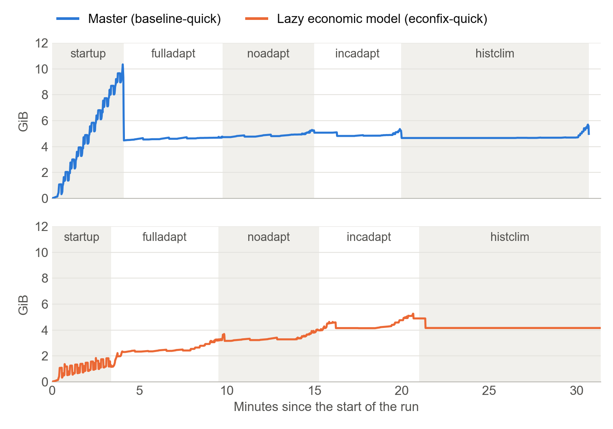
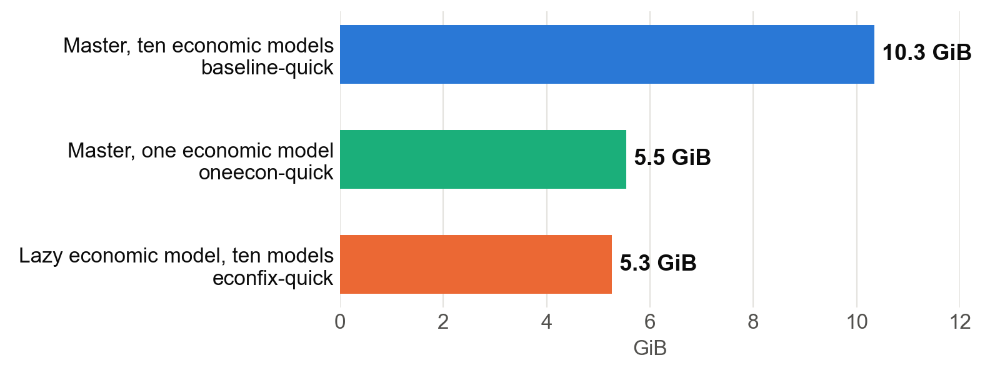
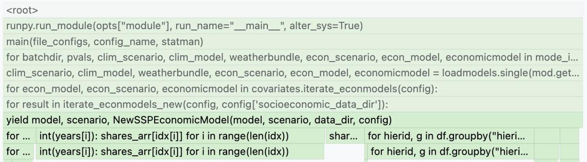
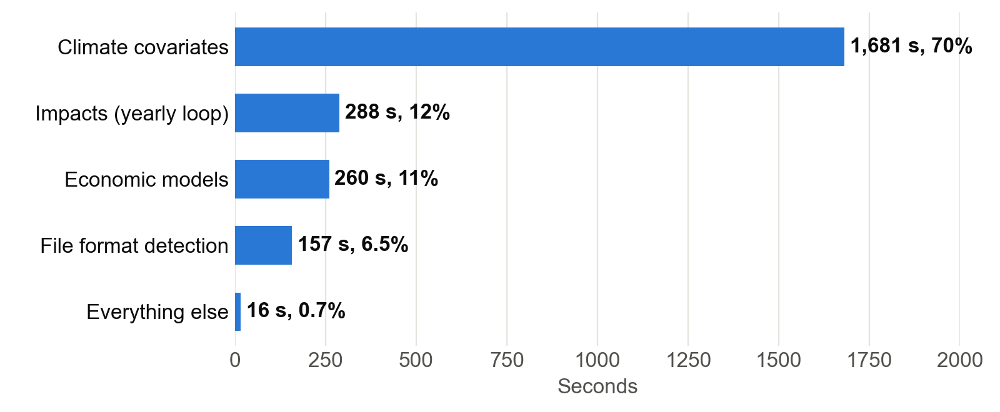

# Memory and time of agriculture quick runs

Quick runs of the winter wheat single restricted to one region, on master and with the lazy econ model, with several setups and two profilers, run on Midway in November 2026. Their memory and timings differ from a full run, and the [full](../2026-11-agri-memory-full/README.md) round measures the peak with all regions.

## Summary

In the memory profile of a quick run, 94.5% of the 9.9 GiB tracked at the peak came from loading the ten economic models. The lazy econ model, which builds the age shares on first use and keeps the population in one array, lowered the agriculture peak from 10.3 to 5.3 GiB, with identical outputs in agriculture and mortality.

In the full single the peak came later, in the histclim covariates, and the lazy econ model did not lower it, 20.4 GiB on master against 22.9 GiB with the lazy econ model. In the full montecarlo unit it lowered the peak from 20.2 to 15.4 GiB.

The time profile puts 70% of a quick run in the climate covariates. Two cores took 30.6 min against 30.7 min on one.

## Setup

Quick runs project one region, [USA.17.906](https://ir-to-adm.vercel.app/?sel=unit%3Aadm2%3AUSA.17.906), for rcp45, CCSM4, SSP3, low. Each used one core, except cores2, which used two. Master is [`ca9da17`](https://github.com/ClimateImpactLab/impact-calculations/commit/ca9da178378ffbadcb149b9666ddd86c2faa7e02). Lazy econ model is [`econmodel-memory`](https://github.com/ClimateImpactLab/impact-calculations/tree/econmodel-memory) at [`61d2f28`](https://github.com/ClimateImpactLab/impact-calculations/commit/61d2f28af62c52e8431a41c517b486ee23c1f1a2), one commit on master.

Memory was profiled with memray 1.17.2 and time with pyinstrument 4.6.2, inside the process, as py-spy cannot attach on Midway (`kernel.yama.ptrace_scope` is 3).

In these quick runs the cgroup peak equals the process peak at one decimal.

## Memory

| run | code | cgroup peak | time of peak | timeline |
|-----|------|-------------|--------------|----------|
| baseline-quick | master, ten economic models | 10.3 GiB | 4 min, while loading the economic models | [timeline][p-base] |
| oneecon-quick | master, one economic model | 5.5 GiB | end of the run | [timeline][p-oneecon] |
| econfix-quick | lazy econ model | 5.3 GiB | 21 min | [timeline][p-econfix] |
| mortality-quick | master | 10.4 GiB | | [timeline][p-mort] |
| mortality_econfix-quick | lazy econ model | 6.4 GiB | | [timeline][p-mortfix] |

The memory profile places 9.4 of the 9.9 GiB tracked at the peak (94.5%) in `NewSSPEconomicModel.__init__` ([flamegraph][memray-fg]). Of that, 4.9 GiB were the age shares (`new_econmodel.py` line 100, 29 million allocations) and 2.9 GiB the population by year (`new_econmodel.py` line 84).

econfix_check built one economic model with each version ([check][c-check]).

| item | master | lazy econ model |
|------|--------|-----------------|
| population by year | 256.6 MB | 28.5 MB |
| age shares at start | 572.5 MB | none (574.1 MB when first read) |
| whole model | 879.4 MB | 78.8 MB |
| time to build | 30.2 s | 20.5 s, plus 9.7 s at the first age-share read |

For ten models, this came to 8.0 GB less.








## Time

| run | wall | loading the economic models |
|-----|------|-----------------------------|
| baseline-quick | 30.7 min | 231 s (3.8 min) |
| oneecon-quick | 27.9 min | 28 s |
| econfix-quick | 31.4 min | 184 s |

The time profile covers 2,402 s of the run ([profile][pyi-html], [speedscope][pyi-ss]).

| part | time | share |
|------|------|-------|
| climate covariates | 1,681 s | 70% |
| impacts in the yearly loop | 288 s | 12% |
| economic models | 260 s | 11% |
| file format detection | 157 s | 6.5% |

histclim took 10.7 min, about twice the other variants (5.0 to 5.6 min), and its covariates took 598 s. `region_groupby` in openest took 913 s of the covariate time with one region, because the seasonal covariates group every region even when filter-region is set.

`threads: 2` on two cores took 30.6 min against 30.7 min on one, in one quick run each ([timeline][p-cores2]). The profilers slowed the run by 31% (time profile) and 36% (memory profile).



## Output checks

Every quick run matched its reference, with no difference in any value.

| run | reference | check | result |
|-----|-----------|-------|--------|
| econfix_check | master | 13 value checks (population, popop, baseline, age shares, the age loader) | [identical][c-check] |
| econfix-quick | master, job 63311055 | `assert_allclose`, four files | [pass][c-econfix] |
| mortality_econfix-quick | master, job 63322423 | `assert_equal`, four files | [pass][c-mortfix] |
| cores2-quick, oneecon-quick, pyinstrument-quick, memray-quick | master, job 63311055 | `assert_allclose`, four files | pass |

## Runs

| run | code | wall | cgroup peak | files |
|-----|------|------|-------------|-------|
| baseline-quick | master | 30.7 min | 10.3 GiB | [details][m-base], [timeline][p-base] |
| cores2-quick | master | 30.6 min | 10.4 GiB | [details][m-cores2], [timeline][p-cores2], [check][c-cores2] |
| oneecon-quick | master | 27.9 min | 5.5 GiB | [details][m-oneecon], [timeline][p-oneecon], [check][c-oneecon] |
| memray-quick | master | 41.7 min | 13.4 GiB (9.9 tracked) | [details][m-memray], [timeline][p-memray], [check][c-memray], [flamegraph][memray-fg] |
| pyinstrument-quick | master | 40.2 min | 10.2 GiB | [details][m-pyi], [timeline][p-pyi], [check][c-pyi], [profile][pyi-html], [speedscope][pyi-ss] |
| econfix_check | master and lazy econ model | | 78.8 MB per model | [check][c-check] |
| econfix-quick | lazy econ model | 31.4 min | 5.3 GiB | [details][m-econfix], [timeline][p-econfix], [check][c-econfix] |
| mortality-quick | master | 8.6 min | 10.4 GiB | [details][m-mort], [timeline][p-mort] |
| mortality_econfix-quick | lazy econ model | 9.0 min | 6.4 GiB | [details][m-mortfix], [timeline][p-mortfix], [check][c-mortfix] |

## Run

- Configs: [`profiling/configs/quick/`](../../profiling/configs/quick/), one per run, for example [`baseline.yml`](../../profiling/configs/quick/baseline.yml). They import the agriculture base config, copied to [`profiling/configs/base/wheat_winter_pbarspline.yml`](../../profiling/configs/base/wheat_winter_pbarspline.yml).
- Jobs and tools: [`profiling/jobs/`](../../profiling/jobs/) and [`profiling/tools/`](../../profiling/tools/), one job per run, for example [`baseline.sbatch`](../../profiling/jobs/baseline.sbatch), all sourcing [`run_experiment.sh`](../../profiling/jobs/run_experiment.sh). On Midway the kit runs from `hpc-jobs/agriculture/profiling/`.
- Python: `/project/cil/home_dirs/rcc/envs/impact-env` (3.7.12), with the profilers from [`profiling/jobs/install_tools.sh`](../../profiling/jobs/install_tools.sh).
- From `hpc-jobs/` on Midway:

```bash
IC=/project/cil/home_dirs/scadavidsanchez/repos/impact-calculations
for e in baseline cores2 oneecon pyinstrument memray; do
    sbatch --export=ALL,QUICK=1,IMPACT_CALCULATIONS=$IC --time=03:00:00 agriculture/profiling/jobs/$e.sbatch
done
sbatch --export=ALL,IMPACT_CALCULATIONS=$IC agriculture/profiling/jobs/econfix_check.sbatch
sbatch --export=ALL,QUICK=1 --time=03:00:00 agriculture/profiling/jobs/econfix.sbatch
MQ=$(sbatch --parsable --export=ALL,IMPACT_CALCULATIONS=$IC agriculture/profiling/jobs/mortality.sbatch)
sbatch --dependency=afterok:$MQ agriculture/profiling/jobs/mortality_econfix.sbatch
sbatch agriculture/profiling/jobs/check.sbatch    # output checks, once all have ended
```

## Data

- `/scratch/midway3/cadavidsanchez/agri-profiling/<run>/`: outputs, run log, 1 s samples and the raw profiles.
- `/project/cil/home_dirs/scadavidsanchez/projects/socioeconomics-update/cil2-hpc-jobs-agriculture/hpc-jobs/agriculture/profiling/results/<run>/`: the memory profile's table, leaks page and summary, and the time profile as text.
- Slurm logs: `/project/cil/home_dirs/scadavidsanchez/projects/socioeconomics-update/cil2-hpc-jobs-agriculture/hpc-jobs/logs/agriculture/profiling/`.

[memray-fg]: https://c1587s.github.io/impact-calculations-experiments/experiments/2026-11-agri-memory/reports/memray-quick/memray-flamegraph.html
[pyi-html]: https://c1587s.github.io/impact-calculations-experiments/experiments/2026-11-agri-memory/reports/pyinstrument-quick/profile.html
[pyi-ss]: https://www.speedscope.app/#profileURL=https%3A%2F%2Fc1587s.github.io%2Fimpact-calculations-experiments%2Fexperiments%2F2026-11-agri-memory%2Freports%2Fpyinstrument-quick%2Fprofile.speedscope.json
[c-check]: https://c1587s.github.io/impact-calculations-experiments/experiments/2026-11-agri-memory/reports/econfix_check/check.json
[p-base]: https://c1587s.github.io/impact-calculations-experiments/perfetto.html?trace=experiments/2026-11-agri-memory/reports/baseline-quick/trace.json
[m-base]: https://c1587s.github.io/impact-calculations-experiments/experiments/2026-11-agri-memory/reports/baseline-quick/manifest.json
[p-cores2]: https://c1587s.github.io/impact-calculations-experiments/perfetto.html?trace=experiments/2026-11-agri-memory/reports/cores2-quick/trace.json
[m-cores2]: https://c1587s.github.io/impact-calculations-experiments/experiments/2026-11-agri-memory/reports/cores2-quick/manifest.json
[c-cores2]: https://c1587s.github.io/impact-calculations-experiments/experiments/2026-11-agri-memory/reports/cores2-quick/check.json
[p-oneecon]: https://c1587s.github.io/impact-calculations-experiments/perfetto.html?trace=experiments/2026-11-agri-memory/reports/oneecon-quick/trace.json
[m-oneecon]: https://c1587s.github.io/impact-calculations-experiments/experiments/2026-11-agri-memory/reports/oneecon-quick/manifest.json
[c-oneecon]: https://c1587s.github.io/impact-calculations-experiments/experiments/2026-11-agri-memory/reports/oneecon-quick/check.json
[p-memray]: https://c1587s.github.io/impact-calculations-experiments/perfetto.html?trace=experiments/2026-11-agri-memory/reports/memray-quick/trace.json
[m-memray]: https://c1587s.github.io/impact-calculations-experiments/experiments/2026-11-agri-memory/reports/memray-quick/manifest.json
[c-memray]: https://c1587s.github.io/impact-calculations-experiments/experiments/2026-11-agri-memory/reports/memray-quick/check.json
[p-pyi]: https://c1587s.github.io/impact-calculations-experiments/perfetto.html?trace=experiments/2026-11-agri-memory/reports/pyinstrument-quick/trace.json
[m-pyi]: https://c1587s.github.io/impact-calculations-experiments/experiments/2026-11-agri-memory/reports/pyinstrument-quick/manifest.json
[c-pyi]: https://c1587s.github.io/impact-calculations-experiments/experiments/2026-11-agri-memory/reports/pyinstrument-quick/check.json
[p-econfix]: https://c1587s.github.io/impact-calculations-experiments/perfetto.html?trace=experiments/2026-11-agri-memory/reports/econfix-quick/trace.json
[m-econfix]: https://c1587s.github.io/impact-calculations-experiments/experiments/2026-11-agri-memory/reports/econfix-quick/manifest.json
[c-econfix]: https://c1587s.github.io/impact-calculations-experiments/experiments/2026-11-agri-memory/reports/econfix-quick/check.json
[p-mort]: https://c1587s.github.io/impact-calculations-experiments/perfetto.html?trace=experiments/2026-11-agri-memory/reports/mortality-quick/trace.json
[m-mort]: https://c1587s.github.io/impact-calculations-experiments/experiments/2026-11-agri-memory/reports/mortality-quick/manifest.json
[p-mortfix]: https://c1587s.github.io/impact-calculations-experiments/perfetto.html?trace=experiments/2026-11-agri-memory/reports/mortality_econfix-quick/trace.json
[m-mortfix]: https://c1587s.github.io/impact-calculations-experiments/experiments/2026-11-agri-memory/reports/mortality_econfix-quick/manifest.json
[c-mortfix]: https://c1587s.github.io/impact-calculations-experiments/experiments/2026-11-agri-memory/reports/mortality_econfix-quick/check.json
