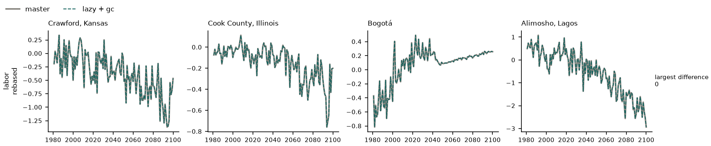
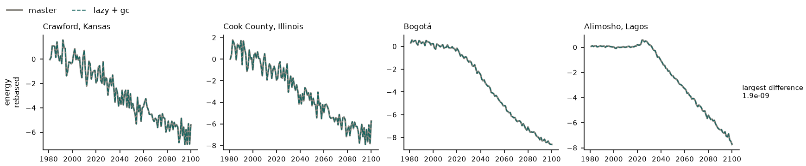

# Memory of the amd round

Singles of the six other crops, labor and energy, and three labor montecarlo units in one job, on master and with the lazy econ model + gc, run on Midway on November 20, 2026. This covers the 12 of 18 runs finished at 10:22. mc3units, mc3units_gccollect_econfix, gc5min_econfix, gcfreeze_econfix and both mortality runs were still running ([runs.csv](../../runs.csv)).

## Summary

Lazy econ model + gc lowered every peak. Labor went from 44.0 to 8.1 GiB, energy from 10.4 to 2.5 GiB, and the crops from 13.0 to 17.6 GiB to 3.7 to 4.3 GiB MaxRSS, 69% to 78% less. The three labor units peaked at 8.7 GiB against 52.3 GiB on master, with no build-up across units. Collections took 1.0% to 2.6% of each run, and all nine checked runs passed.

## Setup

Singles are rcp85, CCSM4, high, SSP3, 1.0.0 socioeconomics. labor_mc3units is batch 0 of the labor montecarlo for CCSM4, GFDL-ESM2M and MIROC5 in one job, with `seed-csvv` fixed. Master is [`ca9da17`][b-master]. Lazy econ model + gc is [econmodel-memory](https://github.com/ClimateImpactLab/impact-calculations/tree/econmodel-memory) at [`61d2f28`][b-fix], with a full collection every 60 s.

Crop masters are job 62444670 (amd, median over its 12 scenarios, sacct MaxRSS). Other peaks are job cgroup peaks.

Labor ran on amd in both versions. The gc runs of energy and the crops ran on cil, with the crops sharing one node, so their wall times are approximate.

## Results

| run | code | partition | wall | cgroup peak | process peak | stage of the peak | request (peak + 20%) |
|-----|------|-----------|------|-------------|--------------|-------------------|----------------------|
| cassava_gccollect_econfix | lazy + gc | cil | 2:38:18 | 3.9 GiB | 3.9 GiB at 2.47 h | calculation setup of global-histclim | 5G |
| corn_gccollect_econfix | lazy + gc | cil | 3:38:24 | 4.1 GiB | 4.1 GiB at 2.40 h | covariates of noadapt-histclim | 5G |
| rice_gccollect_econfix | lazy + gc | cil | 3:25:47 | 4.0 GiB | 4.0 GiB at 3.18 h | covariates of global-histclim | 5G |
| sorghum_gccollect_econfix | lazy + gc | cil | 2:44:21 | 3.9 GiB | 3.9 GiB at 2.08 h | covariates of incadapt-histclim | 5G |
| soy_gccollect_econfix | lazy + gc | cil | 3:40:19 | 4.1 GiB | 4.1 GiB at 1.82 h | covariates of histclim | 5G |
| wheat_spring_gccollect_econfix | lazy + gc | cil | 5:15:46 | 4.4 GiB | 4.4 GiB at 5.02 h | covariates of global-histclim | 6G |
| labor | master | amd | 1:50:27 | 44.0 GiB | 43.9 GiB at 0.90 h | covariates of incadapt | 53G |
| labor_gccollect_econfix | lazy + gc | amd | 2:04:31 | 8.1 GiB | 8.1 GiB at 1.01 h | covariates of incadapt | 10G |
| labor_mc3units | master | amd | 6:26:47 | 52.3 GiB | 52.2 GiB at 1.00 h | covariates of incadapt, first unit | 63G |
| labor_mc3units_gccollect_econfix | lazy + gc | amd | 6:54:08 | 8.7 GiB | 8.7 GiB at 2.86 h | covariates of noadapt, second unit | 11G |
| energy | master | amd | 7:00:11 | 10.4 GiB | 10.4 GiB at 0.07 h | startup, loading the economic models | 13G |
| energy_gccollect_econfix | lazy + gc | cil | 6:46:38 | 2.5 GiB | 2.5 GiB at 6.62 h | year loop of global-histclim | 3G |

Winter wheat's lazy + gc bar is gccollect_econfix from the [gc](../2026-11-agri-memory-gc/README.md) round, on caslake.

## Memory over the run

With lazy + gc the crops stayed between 1.5 and 4.4 GiB after startup and all six peaked in a histclim variant. Between peaks, labor and energy sat at a median of 5.2 GiB on master, against 2.6 and 1.8 GiB with lazy + gc.

## Agriculture

| crop | master hours | master MaxRSS | wall | cgroup peak | MaxRSS | MaxRSS change |
|------|--------------|---------------|------|-------------|--------|---------------|
| cassava | 2.54 h | 13.0 GiB | 2.64 h | 3.9 GiB | 3.8 GiB | 71% lower |
| corn | 3.63 h | 13.4 GiB | 3.64 h | 4.1 GiB | 4.1 GiB | 69% lower |
| rice | 3.62 h | 17.6 GiB | 3.43 h | 4.0 GiB | 3.9 GiB | 78% lower |
| sorghum | 2.76 h | 13.4 GiB | 2.74 h | 3.9 GiB | 3.7 GiB | 72% lower |
| soy | 3.74 h | 13.4 GiB | 3.67 h | 4.1 GiB | 4.1 GiB | 69% lower |
| wheat_spring | 5.41 h | 15.9 GiB | 5.26 h | 4.4 GiB | 4.3 GiB | 73% lower |

Wall times were 0.95 to 1.04 times the master medians, with 1.7 to 5.0 min of collections per crop.

## Labor

| job memory by stage | labor | labor_gccollect_econfix |
|---------------------|-------|-------------------------|
| startup peak | 10.4 GiB | 2.1 GiB |
| year loop of fulladapt (highest) | 11.5 GiB | 5.9 GiB |
| year loop of noadapt (start to end) | 4.9 to 39.8 GiB | 1.9 to 3.2 GiB |
| covariates of incadapt (highest) | 44.0 GiB | 8.1 GiB |
| year loop of histclim (highest) | 10.0 GiB | 6.8 GiB |

On master, memory climbed from 4.9 to 39.8 GiB through the noadapt year loop and peaked at 44.0 GiB in the incadapt covariates. With lazy + gc that loop stayed at or below 5.7 GiB.

| run | unit | GCM | starts at | hours | process memory at start | cgroup peak |
|-----|------|-----|-----------|-------|-------------------------|-------------|
| labor_mc3units | 1 | CCSM4 | 0.1 h | 1.9 | 10.0 GiB | 52.3 GiB |
| labor_mc3units | 2 | GFDL-ESM2M | 2.0 h | 2.2 | 11.4 GiB | 35.9 GiB |
| labor_mc3units | 3 | MIROC5 | 4.2 h | 2.2 | 11.5 GiB | 51.8 GiB |
| labor_mc3units_gccollect_econfix | 1 | MIROC5 | 0.1 h | 2.1 | 1.3 GiB | 8.5 GiB |
| labor_mc3units_gccollect_econfix | 2 | CCSM4 | 2.2 h | 2.3 | 2.4 GiB | 8.7 GiB |
| labor_mc3units_gccollect_econfix | 3 | GFDL-ESM2M | 4.5 h | 2.4 | 2.4 GiB | 8.7 GiB |

Memory at unit start rose by 1.4 GiB on master and 1.1 GiB with lazy + gc from the first unit to the second, then held. On master the GFDL-ESM2M unit peaked about 16 GiB below the other two.

## Energy

Master peaked at startup, 10.4 GiB while loading the economic models, then held at 5.0 to 5.7 GiB. Lazy + gc held near 1.8 GiB and peaked at 2.5 GiB in the last variant.

## Time cost of garbage collection

| run | collections | total | share of the run | median | longest |
|-----|-------------|-------|------------------|--------|---------|
| cassava_gccollect_econfix | 158 | 1.7 min | 1.0% | 0.7 s | 1.0 s |
| corn_gccollect_econfix | 218 | 2.1 min | 1.0% | 0.7 s | 0.8 s |
| rice_gccollect_econfix | 205 | 3.3 min | 1.6% | 1.0 s | 1.3 s |
| sorghum_gccollect_econfix | 164 | 1.7 min | 1.0% | 0.7 s | 0.8 s |
| soy_gccollect_econfix | 220 | 2.2 min | 1.0% | 0.7 s | 0.8 s |
| wheat_spring_gccollect_econfix | 315 | 5.0 min | 1.6% | 1.0 s | 1.3 s |
| labor_gccollect_econfix | 124 | 3.0 min | 2.4% | 1.6 s | 3.3 s |
| labor_mc3units_gccollect_econfix | 414 | 10.6 min | 2.6% | 1.7 s | 5.1 s |
| energy_gccollect_econfix | 406 | 6.0 min | 1.5% | 0.9 s | 1.4 s |

| run | wall | against | its wall | ratio |
|-----|------|---------|----------|-------|
| labor_gccollect_econfix | 2:04:31 (amd) | labor | 1:50:27 (amd) | 1.13 |
| labor_mc3units_gccollect_econfix | 6:54:08 (amd) | labor_mc3units | 6:26:47 (amd) | 1.07 |
| energy_gccollect_econfix | 6:46:38 (cil) | energy | 7:00:11 (amd) | 0.97 |

Labor took 14.1 min more with lazy + gc and the three units 27.4 min more, against 3.0 and 10.6 min of collections.

## Output checks

| run | reference | files | identical | largest difference | result |
|-----|-----------|-------|-----------|--------------------|--------|
| cassava_gccollect_econfix | agriculture/cassava/single/rcp85/CCSM4/high/SSP3 | 8 | 5 | 2.2e-08 | [pass][c-cas] |
| corn_gccollect_econfix | agriculture/corn/single/rcp85/CCSM4/high/SSP3 | 8 | 5 | 3.0e-08 | [pass][c-corn] |
| rice_gccollect_econfix | agriculture/rice/single/rcp85/CCSM4/high/SSP3 | 8 | 6 | 5.8e-11 | [pass][c-rice] |
| sorghum_gccollect_econfix | agriculture/sorghum/single/rcp85/CCSM4/high/SSP3 | 8 | 7 | 1.8e-12 | [pass][c-sorg] |
| soy_gccollect_econfix | agriculture/soy/single/rcp85/CCSM4/high/SSP3 | 8 | 6 | 5.8e-11 | [pass][c-soy] |
| wheat_spring_gccollect_econfix | agriculture/wheat_spring/single/rcp85/CCSM4/high/SSP3 | 8 | 2 | 9.3e-10 | [pass][c-wsp] |
| labor_gccollect_econfix | labor/single/rcp85/CCSM4/high/SSP3 | 4 | 4 | 0 | [pass][c-lab] |
| labor_mc3units_gccollect_econfix | master, job 63567902 | 12 | 12 | 0 | [pass][c-lmc] |
| energy_gccollect_econfix | energy/other_energy/single/rcp85/CCSM4/high/SSP3 | 8 | 3 | 1.9e-09 | [pass][c-en] |

Paths are under `/project/cil/gcp/outputs_newsocioeconomics/`. Pass means every variable is within rtol 1e-5 and atol 1e-8. The small differences in the crops and energy come from master and lazy + gc running on different CPU types. Labor, on amd for both, is identical.

## Same outputs

Master against lazy + gc over the years in four regions, with the largest absolute difference of every file in the CSV next to each PNG ([agriculture](same_outputs/agriculture.csv), [labor](same_outputs/labor.csv), [energy](same_outputs/energy.csv)). The largest difference is 3.0e-08 in agriculture, 1.9e-09 in energy and 0 in labor.

Mortality is pending.

## Runs

| run | code | wall | cgroup peak | files |
|-----|------|------|-------------|-------|
| cassava_gccollect_econfix | lazy + gc [`61d2f28`][b-fix] | 2:38:18 (cil) | 3.9 GiB | [details][m-cas], [timeline][p-cas], [stages][s-cas], [check][c-cas], [collections][g-cas] |
| corn_gccollect_econfix | lazy + gc [`61d2f28`][b-fix] | 3:38:24 (cil) | 4.1 GiB | [details][m-corn], [timeline][p-corn], [stages][s-corn], [check][c-corn], [collections][g-corn] |
| rice_gccollect_econfix | lazy + gc [`61d2f28`][b-fix] | 3:25:47 (cil) | 4.0 GiB | [details][m-rice], [timeline][p-rice], [stages][s-rice], [check][c-rice], [collections][g-rice] |
| sorghum_gccollect_econfix | lazy + gc [`61d2f28`][b-fix] | 2:44:21 (cil) | 3.9 GiB | [details][m-sorg], [timeline][p-sorg], [stages][s-sorg], [check][c-sorg], [collections][g-sorg] |
| soy_gccollect_econfix | lazy + gc [`61d2f28`][b-fix] | 3:40:19 (cil) | 4.1 GiB | [details][m-soy], [timeline][p-soy], [stages][s-soy], [check][c-soy], [collections][g-soy] |
| wheat_spring_gccollect_econfix | lazy + gc [`61d2f28`][b-fix] | 5:15:46 (cil) | 4.4 GiB | [details][m-wsp], [timeline][p-wsp], [stages][s-wsp], [check][c-wsp], [collections][g-wsp] |
| labor | master [`ca9da17`][b-master] | 1:50:27 (amd) | 44.0 GiB | [details][m-labm], [timeline][p-labm], [stages][s-labm] |
| labor_gccollect_econfix | lazy + gc [`61d2f28`][b-fix] | 2:04:31 (amd) | 8.1 GiB | [details][m-lab], [timeline][p-lab], [stages][s-lab], [check][c-lab], [collections][g-lab] |
| labor_mc3units | master [`ca9da17`][b-master] | 6:26:47 (amd) | 52.3 GiB | [details][m-lmcm], [timeline][p-lmcm], [stages][s-lmcm] |
| labor_mc3units_gccollect_econfix | lazy + gc [`61d2f28`][b-fix] | 6:54:08 (amd) | 8.7 GiB | [details][m-lmc], [timeline][p-lmc], [stages][s-lmc], [check][c-lmc], [collections][g-lmc] |
| energy | master [`ca9da17`][b-master] | 7:00:11 (amd) | 10.4 GiB | [details][m-enm], [timeline][p-enm], [stages][s-enm] |
| energy_gccollect_econfix | lazy + gc [`61d2f28`][b-fix] | 6:46:38 (cil) | 2.5 GiB | [details][m-en], [timeline][p-en], [stages][s-en], [check][c-en], [collections][g-en] |

## Run

- Configs: [`profiling/configs/`](../../profiling/configs/). Jobs: [`profiling/jobs/`](../../profiling/jobs/), the gc runs through [`gc_capture.py`](../../profiling/tools/gc_capture.py) with `--interval 60`.
- Output checks and same outputs: [`same_outputs.sbatch`](../../profiling/jobs/same_outputs.sbatch), with [`same_outputs.py`](same_outputs/same_outputs.py).
- Figures and tables: [`amd_round.py`](../../profiling/notebooks/amd_round.py) with `RESULTS_ROOT=reports/` and `FIGURES=figures/`.
- Submission: steps 7 and 9 of the kit [README](../../profiling/README.md).

## Data

- `/scratch/midway3/cadavidsanchez/agri-profiling/<run>/`: outputs and raw samples.
- `/project/cil/gcp/outputs_newsocioeconomics/<sector>/[<crop>/]single/rcp85/CCSM4/high/SSP3/`: master outputs, the reference of every single.
- `/project/cil/home_dirs/scadavidsanchez/projects/socioeconomics-update/checks/agriculture/profiling-amd/`: 1 s samples, run logs, collection logs, Slurm logs and `sacct_all.csv`.

[b-master]: https://github.com/ClimateImpactLab/impact-calculations/commit/ca9da178378ffbadcb149b9666ddd86c2faa7e02
[b-fix]: https://github.com/ClimateImpactLab/impact-calculations/commit/61d2f28af62c52e8431a41c517b486ee23c1f1a2
[m-cas]: reports/cassava_gccollect_econfix/manifest.json
[p-cas]: https://c1587s.github.io/impact-calculations-experiments/perfetto.html?trace=experiments/2026-11-amd-round/reports/cassava_gccollect_econfix/trace.json
[s-cas]: reports/cassava_gccollect_econfix/markers.tsv
[c-cas]: reports/cassava_gccollect_econfix/check.json
[g-cas]: reports/cassava_gccollect_econfix/gc.csv
[m-corn]: reports/corn_gccollect_econfix/manifest.json
[p-corn]: https://c1587s.github.io/impact-calculations-experiments/perfetto.html?trace=experiments/2026-11-amd-round/reports/corn_gccollect_econfix/trace.json
[s-corn]: reports/corn_gccollect_econfix/markers.tsv
[c-corn]: reports/corn_gccollect_econfix/check.json
[g-corn]: reports/corn_gccollect_econfix/gc.csv
[m-rice]: reports/rice_gccollect_econfix/manifest.json
[p-rice]: https://c1587s.github.io/impact-calculations-experiments/perfetto.html?trace=experiments/2026-11-amd-round/reports/rice_gccollect_econfix/trace.json
[s-rice]: reports/rice_gccollect_econfix/markers.tsv
[c-rice]: reports/rice_gccollect_econfix/check.json
[g-rice]: reports/rice_gccollect_econfix/gc.csv
[m-sorg]: reports/sorghum_gccollect_econfix/manifest.json
[p-sorg]: https://c1587s.github.io/impact-calculations-experiments/perfetto.html?trace=experiments/2026-11-amd-round/reports/sorghum_gccollect_econfix/trace.json
[s-sorg]: reports/sorghum_gccollect_econfix/markers.tsv
[c-sorg]: reports/sorghum_gccollect_econfix/check.json
[g-sorg]: reports/sorghum_gccollect_econfix/gc.csv
[m-soy]: reports/soy_gccollect_econfix/manifest.json
[p-soy]: https://c1587s.github.io/impact-calculations-experiments/perfetto.html?trace=experiments/2026-11-amd-round/reports/soy_gccollect_econfix/trace.json
[s-soy]: reports/soy_gccollect_econfix/markers.tsv
[c-soy]: reports/soy_gccollect_econfix/check.json
[g-soy]: reports/soy_gccollect_econfix/gc.csv
[m-wsp]: reports/wheat_spring_gccollect_econfix/manifest.json
[p-wsp]: https://c1587s.github.io/impact-calculations-experiments/perfetto.html?trace=experiments/2026-11-amd-round/reports/wheat_spring_gccollect_econfix/trace.json
[s-wsp]: reports/wheat_spring_gccollect_econfix/markers.tsv
[c-wsp]: reports/wheat_spring_gccollect_econfix/check.json
[g-wsp]: reports/wheat_spring_gccollect_econfix/gc.csv
[m-labm]: reports/labor/manifest.json
[p-labm]: https://c1587s.github.io/impact-calculations-experiments/perfetto.html?trace=experiments/2026-11-amd-round/reports/labor/trace.json
[s-labm]: reports/labor/markers.tsv
[m-lab]: reports/labor_gccollect_econfix/manifest.json
[p-lab]: https://c1587s.github.io/impact-calculations-experiments/perfetto.html?trace=experiments/2026-11-amd-round/reports/labor_gccollect_econfix/trace.json
[s-lab]: reports/labor_gccollect_econfix/markers.tsv
[c-lab]: reports/labor_gccollect_econfix/check.json
[g-lab]: reports/labor_gccollect_econfix/gc.csv
[m-lmcm]: reports/labor_mc3units/manifest.json
[p-lmcm]: https://c1587s.github.io/impact-calculations-experiments/perfetto.html?trace=experiments/2026-11-amd-round/reports/labor_mc3units/trace.json
[s-lmcm]: reports/labor_mc3units/markers.tsv
[m-lmc]: reports/labor_mc3units_gccollect_econfix/manifest.json
[p-lmc]: https://c1587s.github.io/impact-calculations-experiments/perfetto.html?trace=experiments/2026-11-amd-round/reports/labor_mc3units_gccollect_econfix/trace.json
[s-lmc]: reports/labor_mc3units_gccollect_econfix/markers.tsv
[c-lmc]: reports/labor_mc3units_gccollect_econfix/check.json
[g-lmc]: reports/labor_mc3units_gccollect_econfix/gc.csv
[m-enm]: reports/energy/manifest.json
[p-enm]: https://c1587s.github.io/impact-calculations-experiments/perfetto.html?trace=experiments/2026-11-amd-round/reports/energy/trace.json
[s-enm]: reports/energy/markers.tsv
[m-en]: reports/energy_gccollect_econfix/manifest.json
[p-en]: https://c1587s.github.io/impact-calculations-experiments/perfetto.html?trace=experiments/2026-11-amd-round/reports/energy_gccollect_econfix/trace.json
[s-en]: reports/energy_gccollect_econfix/markers.tsv
[c-en]: reports/energy_gccollect_econfix/check.json
[g-en]: reports/energy_gccollect_econfix/gc.csv
