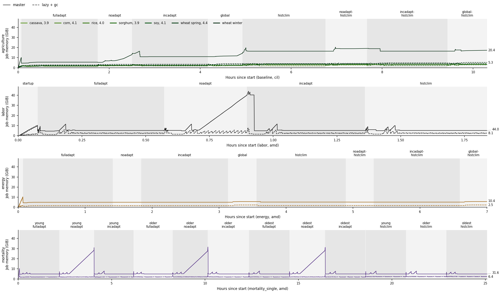
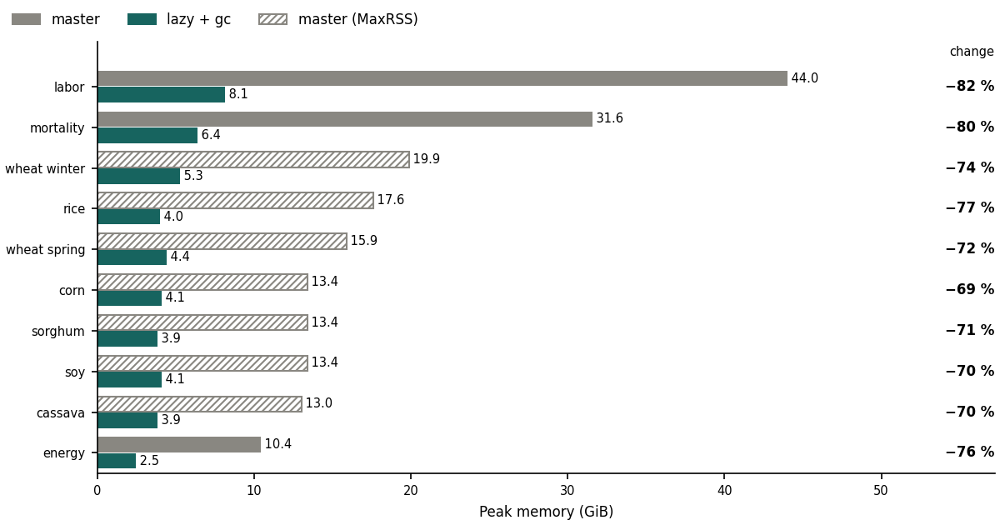
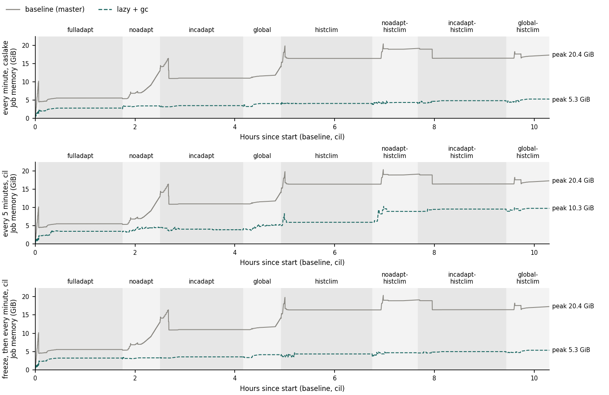
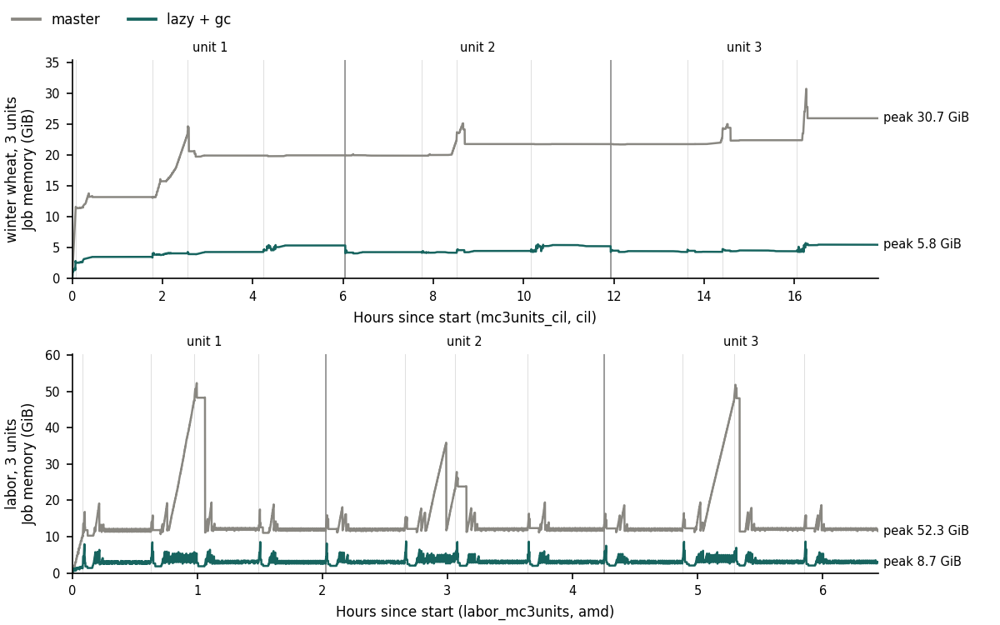
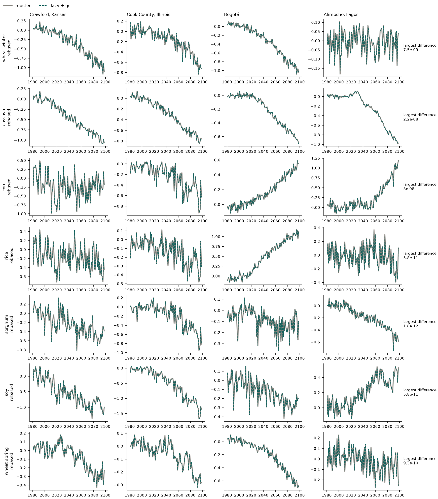
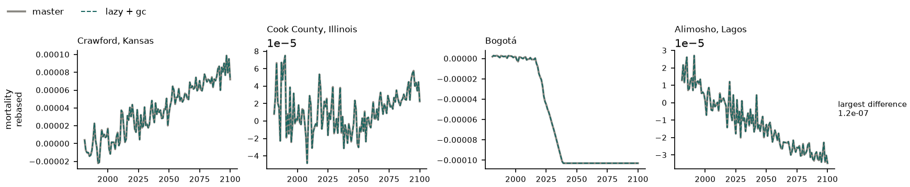

# Memory of the amd round

Singles of the six other crops, labor, energy and mortality, three montecarlo units in one job for winter wheat and labor, and the winter wheat single under three gc settings, on master and with the lazy econ model + gc, run on Midway on November 20 and 21, 2026. All 18 runs finished ([runs.csv](../../runs.csv)).

## Summary

Lazy econ model + gc lowered every peak. Labor went from 44.0 to 8.1 GiB, energy from 10.4 to 2.5 GiB, mortality from 31.6 to 6.4 GiB, and the crops from 13.0 to 17.6 GiB to 3.7 to 4.3 GiB MaxRSS, 69% to 78% less. With three units in one job, winter wheat peaked at 5.8 GiB against 30.7 GiB for master on the same partition (mc3units_cil). Labor peaked at 8.7 against 52.3 GiB. In mc3units_cil, memory at the start of each winter wheat unit grew from 10.0 to 19.7 and 21.5 GiB, and with lazy + gc from 1.3 to 4.0 and 4.3 GiB.

A collection every 5 minutes left the winter wheat single at 10.3 GiB, against 5.3 GiB with a collection every minute and with gc.freeze. Collections took 0.5% to 2.5% of each run. With the collection in the code, the single peaked at 5.3 GiB and took 10:19:31 against 10:18:44 for baseline, both on cil. Every checked run passed except mc3units_gccollect_econfix, whose twelve files differ from mc3units. mc3units_cil, the same master run on cil, matched mc3units_gccollect_econfix in all twelve files, so the difference seems to come from running on amd.

## Setup

- Singles are rcp85, CCSM4, high, SSP3, 1.0.0 socioeconomics.
- mc3units and labor_mc3units are batch 0 of the winter wheat and labor montecarlo for CCSM4, GFDL-ESM2M and MIROC5 in one job, with `seed-csvv` fixed.
- mc3units_cil is mc3units on cil, with the same config and seeds.
- Master is [`d642a03`][b-master], `ca9da17` with the additional SSPs, which every run used.
- Lazy econ model is [`e033e7b`][b-fix], one commit on top.
- Lazy + gc runs collect every 60 s through the kit's `gc_capture.py`.
- gc5min_econfix collects every 300 s.
- gcfreeze_econfix runs `gc.freeze()` when the first variant starts, then collects every 60 s.
- The periodicgc runs use [`cc28bb1`][b-gc], which collects from the code when the config sets `gc-interval`.
- All three commits are on [econmodel-memory](https://github.com/ClimateImpactLab/impact-calculations/tree/econmodel-memory).
- Crop masters are job 62444670 (amd, median over its 12 scenarios, sacct MaxRSS).
- Other peaks are job cgroup peaks.
- Labor ran on amd in both versions.
- The other masters ran on amd, except mc3units_cil on cil, and the other gc runs shared one cil node, so their wall times are approximate.

## Memory over the run

With lazy + gc the crops stayed between 1.5 and 4.4 GiB after startup and all six peaked in a histclim variant. Between peaks, labor, energy and mortality sat at a median of about 5 GiB on master, against 2.6, 1.8 and 2.0 GiB with lazy + gc.

## Results

| run | code | partition | wall | cgroup peak | process peak | stage of the peak | request (peak + 20%) |
|-----|------|-----------|------|-------------|--------------|-------------------|----------------------|
| cassava_gccollect_econfix | lazy + gc | cil | 2:38:36 | 3.9 GiB | 3.9 GiB at 2.47 h | calculation setup of global-histclim | 5G |
| corn_gccollect_econfix | lazy + gc | cil | 3:38:34 | 4.1 GiB | 4.1 GiB at 2.40 h | covariates of noadapt-histclim | 5G |
| rice_gccollect_econfix | lazy + gc | cil | 3:26:03 | 4.0 GiB | 4.0 GiB at 3.18 h | covariates of global-histclim | 5G |
| sorghum_gccollect_econfix | lazy + gc | cil | 2:44:30 | 3.9 GiB | 3.9 GiB at 2.08 h | covariates of incadapt-histclim | 5G |
| soy_gccollect_econfix | lazy + gc | cil | 3:40:28 | 4.1 GiB | 4.1 GiB at 1.82 h | covariates of histclim | 5G |
| wheat_spring_gccollect_econfix | lazy + gc | cil | 5:16:05 | 4.4 GiB | 4.4 GiB at 5.02 h | covariates of global-histclim | 6G |
| mc3units | master | amd | 23:36:10 | 25.4 GiB | 25.3 GiB at 11.48 h | covariates of incadapt, second unit | 31G |
| mc3units_cil | master | cil | 17:51:26 | 30.7 GiB | 30.4 GiB at 16.27 h | covariates of histclim, third unit | 37G |
| mc3units_gccollect_econfix | lazy + gc | cil | 17:51:26 | 5.8 GiB | 5.7 GiB at 16.27 h | covariates of histclim, third unit | 7G |
| gc5min_econfix | lazy + gc, every 5 min | cil | 10:06:55 | 10.3 GiB | 10.3 GiB at 6.92 h | covariates of noadapt-histclim | 13G |
| gcfreeze_econfix | lazy + gc, gc.freeze | cil | 10:06:55 | 5.3 GiB | 5.2 GiB at 9.97 h | year loop of global-histclim | 7G |
| labor | master | amd | 1:50:55 | 44.0 GiB | 43.9 GiB at 0.90 h | covariates of incadapt | 53G |
| labor_gccollect_econfix | lazy + gc | amd | 2:04:53 | 8.1 GiB | 8.1 GiB at 1.01 h | covariates of incadapt | 10G |
| labor_mc3units | master | amd | 6:27:06 | 52.3 GiB | 52.2 GiB at 1.00 h | covariates of incadapt, first unit | 63G |
| labor_mc3units_gccollect_econfix | lazy + gc | amd | 6:54:46 | 8.7 GiB | 8.7 GiB at 2.86 h | covariates of noadapt, second unit | 11G |
| energy | master | amd | 7:00:30 | 10.4 GiB | 10.4 GiB at 0.07 h | startup, loading the economic models | 13G |
| energy_gccollect_econfix | lazy + gc | cil | 6:47:07 | 2.5 GiB | 2.5 GiB at 6.62 h | year loop of global-histclim | 3G |
| mortality_single | master | amd | 25:05:51 | 31.6 GiB | 31.5 GiB at 10.16 h | covariates of older incadapt | 38G |
| mortality_single_gccollect_econfix | lazy + gc | cil | 21:42:00 | 6.4 GiB | 6.3 GiB at 7.30 h | covariates of older noadapt | 8G |

Winter wheat's lazy + gc bar is gccollect_econfix from the [gc](../2026-11-agri-memory-gc/README.md) round, on caslake.

## Agriculture

| crop | master hours | master MaxRSS | wall | cgroup peak | MaxRSS | MaxRSS change |
|------|--------------|---------------|------|-------------|--------|---------------|
| cassava | 2.54 h | 13.0 GiB | 2.64 h | 3.9 GiB | 3.8 GiB | 71% lower |
| corn | 3.63 h | 13.4 GiB | 3.64 h | 4.1 GiB | 4.1 GiB | 69% lower |
| rice | 3.62 h | 17.6 GiB | 3.43 h | 4.0 GiB | 3.9 GiB | 78% lower |
| sorghum | 2.76 h | 13.4 GiB | 2.74 h | 3.9 GiB | 3.7 GiB | 72% lower |
| soy | 3.74 h | 13.4 GiB | 3.67 h | 4.1 GiB | 4.1 GiB | 69% lower |
| wheat_spring | 5.41 h | 15.9 GiB | 5.27 h | 4.4 GiB | 4.3 GiB | 73% lower |

Wall times were 0.95 to 1.04 times the master medians, with 1.7 to 5.0 min of collections per crop.

## gc settings

| setting | run | partition | wall | cgroup peak | collections | total | share of the run | median |
|---------|-----|-----------|------|-------------|-------------|-------|------------------|--------|
| every minute | gccollect_econfix | caslake | 12:13:20 | 5.3 GiB | 732 | 24.7 min | 3.4% | 1.9 s |
| every 5 minutes | gc5min_econfix | cil | 10:06:55 | 10.3 GiB | 121 | 3.1 min | 0.5% | 1.7 s |
| gc.freeze, then every minute | gcfreeze_econfix | cil | 10:06:55 | 5.3 GiB | 607 | 14.6 min | 2.4% | 1.6 s |

Every 5 minutes, memory stayed near the minute setting until histclim, rose there and peaked at 10.3 GiB in the covariates of noadapt-histclim. With gc.freeze the run peaked at 5.3 GiB, as with a collection every minute, and its collections took 14.6 min against 24.7 min, on another partition.

## gc in the code

periodicgc_off-quick and periodicgc-quick are econfix-quick on [`cc28bb1`][b-gc] without and with `gc-interval: 60`, and periodicgc is the winter wheat single with `gc-interval: 60`, all on cil with no wrapper.

| run | gc-interval | wall | cgroup peak | process peak | stage of the peak |
|-----|-------------|------|-------------|--------------|-------------------|
| periodicgc_off-quick | none | 0:29:01 | 5.4 GiB | 5.4 GiB at 0.31 h | year loop of incadapt |
| periodicgc-quick | 60 s | 0:29:01 | 3.6 GiB | 3.6 GiB at 0.48 h | year loop of histclim |
| periodicgc | 60 s | 10:19:31 | 5.3 GiB | 5.1 GiB at 10.05 h | year loop of global-histclim |

The two quick runs gave identical outputs. periodicgc peaked at 5.3 GiB, as gccollect_econfix with the wrapper, passed against the master single, and took 10:19:31 against 10:18:44 for baseline. It writes no collection log, so collection times are not measured.

## Labor

| job memory by stage | labor | labor_gccollect_econfix |
|---------------------|-------|-------------------------|
| startup peak | 10.4 GiB | 2.1 GiB |
| year loop of fulladapt (highest) | 11.5 GiB | 5.9 GiB |
| year loop of noadapt (start to end) | 4.9 to 39.8 GiB | 1.9 to 3.2 GiB |
| covariates of incadapt (highest) | 44.0 GiB | 8.1 GiB |
| year loop of histclim (highest) | 10.0 GiB | 6.8 GiB |

On master, memory climbed from 4.9 to 39.8 GiB through the noadapt year loop and peaked at 44.0 GiB in the incadapt covariates. With lazy + gc that loop stayed at or below 5.7 GiB.

## Energy

Master peaked at startup, 10.4 GiB while loading the economic models, then held at 5.0 to 5.7 GiB. Lazy + gc held near 1.8 GiB and peaked at 2.5 GiB in the last variant.

## Mortality

On master, memory climbed from about 4.8 to 29 GiB through the noadapt year loop of each age group and peaked at 31.0 to 31.6 GiB in the incadapt covariates that follow, the highest in older. Lazy + gc held near 2.0 GiB and peaked at 6.4 GiB in the covariates of older noadapt.

## Three units in one job

| run | unit | GCM | starts at | hours | process memory at start | cgroup peak |
|-----|------|-----|-----------|-------|-------------------------|-------------|
| mc3units | 1 | CCSM4 | 0.1 h | 7.9 | 10.0 GiB | 24.4 GiB |
| mc3units | 2 | GFDL-ESM2M | 7.9 h | 7.9 | 19.9 GiB | 25.4 GiB |
| mc3units | 3 | MIROC5 | 15.9 h | 7.7 | 21.9 GiB | 22.1 GiB |
| mc3units_cil | 1 | GFDL-ESM2M | 0.1 h | 6.0 | 10.0 GiB | 24.6 GiB |
| mc3units_cil | 2 | MIROC5 | 6.1 h | 5.9 | 19.7 GiB | 25.1 GiB |
| mc3units_cil | 3 | CCSM4 | 11.9 h | 5.9 | 21.5 GiB | 30.7 GiB |
| mc3units_gccollect_econfix | 1 | CCSM4 | 0.1 h | 5.9 | 1.3 GiB | 5.5 GiB |
| mc3units_gccollect_econfix | 2 | MIROC5 | 6.0 h | 5.9 | 4.0 GiB | 5.6 GiB |
| mc3units_gccollect_econfix | 3 | GFDL-ESM2M | 11.9 h | 5.9 | 4.3 GiB | 5.8 GiB |
| labor_mc3units | 1 | CCSM4 | 0.1 h | 1.9 | 10.0 GiB | 52.3 GiB |
| labor_mc3units | 2 | GFDL-ESM2M | 2.0 h | 2.2 | 11.4 GiB | 35.9 GiB |
| labor_mc3units | 3 | MIROC5 | 4.2 h | 2.2 | 11.5 GiB | 51.8 GiB |
| labor_mc3units_gccollect_econfix | 1 | MIROC5 | 0.1 h | 2.1 | 1.3 GiB | 8.5 GiB |
| labor_mc3units_gccollect_econfix | 2 | CCSM4 | 2.2 h | 2.3 | 2.4 GiB | 8.7 GiB |
| labor_mc3units_gccollect_econfix | 3 | GFDL-ESM2M | 4.5 h | 2.4 | 2.4 GiB | 8.7 GiB |

In winter wheat, memory at unit start grew by 9.9 and 2.0 GiB on master and by 2.7 and 0.3 GiB with lazy + gc. On cil, master grew by 9.7 and 1.8 GiB and peaked at 30.7 GiB in its third unit. In labor it rose by 1.4 GiB on master and 1.1 GiB with lazy + gc from the first unit to the second, then held, and on master the GFDL-ESM2M unit peaked about 16 GiB below the other two.

## Time cost of garbage collection

| run | collections | total | share of the run | median | longest |
|-----|-------------|-------|------------------|--------|---------|
| cassava_gccollect_econfix | 158 | 1.7 min | 1.0% | 0.7 s | 1.0 s |
| corn_gccollect_econfix | 218 | 2.1 min | 1.0% | 0.7 s | 0.8 s |
| rice_gccollect_econfix | 205 | 3.3 min | 1.6% | 1.0 s | 1.3 s |
| sorghum_gccollect_econfix | 164 | 1.7 min | 1.0% | 0.7 s | 0.8 s |
| soy_gccollect_econfix | 220 | 2.2 min | 1.0% | 0.7 s | 0.8 s |
| wheat_spring_gccollect_econfix | 315 | 5.0 min | 1.6% | 1.0 s | 1.3 s |
| mc3units_gccollect_econfix | 1071 | 27.1 min | 2.5% | 1.8 s | 2.9 s |
| gc5min_econfix | 121 | 3.1 min | 0.5% | 1.7 s | 2.0 s |
| gcfreeze_econfix | 607 | 14.6 min | 2.4% | 1.6 s | 2.0 s |
| labor_gccollect_econfix | 124 | 3.0 min | 2.4% | 1.6 s | 3.3 s |
| labor_mc3units_gccollect_econfix | 414 | 10.6 min | 2.5% | 1.7 s | 5.1 s |
| energy_gccollect_econfix | 406 | 6.0 min | 1.5% | 0.9 s | 1.4 s |
| mortality_single_gccollect_econfix | 1301 | 19.4 min | 1.5% | 1.0 s | 1.2 s |

| run | wall | against | its wall | ratio |
|-----|------|---------|----------|-------|
| labor_gccollect_econfix | 2:04:53 (amd) | labor | 1:50:55 (amd) | 1.13 |
| labor_mc3units_gccollect_econfix | 6:54:46 (amd) | labor_mc3units | 6:27:06 (amd) | 1.07 |
| mc3units_gccollect_econfix | 17:51:26 (cil) | mc3units | 23:36:10 (amd) | 0.76 |
| mc3units_gccollect_econfix | 17:51:26 (cil) | mc3units_cil | 17:51:26 (cil) | 1.00 |
| periodicgc | 10:19:31 (cil) | baseline | 10:18:44 (cil) | 1.00 |
| energy_gccollect_econfix | 6:47:07 (cil) | energy | 7:00:30 (amd) | 0.97 |
| mortality_single_gccollect_econfix | 21:42:00 (cil) | mortality_single | 25:05:51 (amd) | 0.86 |

Labor took 14.0 min more with lazy + gc and the three units 27.7 min more, against 3.0 and 10.6 min of collections.

## Output checks

| run | reference | files | identical | largest difference | result |
|-----|-----------|-------|-----------|--------------------|--------|
| cassava_gccollect_econfix | agriculture/cassava/single/rcp85/CCSM4/high/SSP3 | 8 | 5 | 2.2e-08 | [pass][c-cas] |
| corn_gccollect_econfix | agriculture/corn/single/rcp85/CCSM4/high/SSP3 | 8 | 5 | 3.0e-08 | [pass][c-corn] |
| rice_gccollect_econfix | agriculture/rice/single/rcp85/CCSM4/high/SSP3 | 8 | 6 | 5.8e-11 | [pass][c-rice] |
| sorghum_gccollect_econfix | agriculture/sorghum/single/rcp85/CCSM4/high/SSP3 | 8 | 7 | 1.8e-12 | [pass][c-sorg] |
| soy_gccollect_econfix | agriculture/soy/single/rcp85/CCSM4/high/SSP3 | 8 | 6 | 5.8e-11 | [pass][c-soy] |
| wheat_spring_gccollect_econfix | agriculture/wheat_spring/single/rcp85/CCSM4/high/SSP3 | 8 | 2 | 9.3e-10 | [pass][c-wsp] |
| mc3units_gccollect_econfix | master, job 63567890 | 12 | 0 | 8.6e+02 | [fail][c-mc3] |
| mcunit_gfdl_gccollect_econfix | mc3units_gccollect_econfix, job 63567891 | 4 | 4 | 0 | [pass][c-mcg] |
| mcunit_miroc5_gccollect_econfix | mc3units_gccollect_econfix, job 63567891 | 4 | 4 | 0 | [pass][c-mcm] |
| mc3units_cil | mc3units_gccollect_econfix, job 63567891 | 12 | 12 | 0 | [pass][c-mcc] |
| mc3units_cil, CCSM4 | master, job 63433857 | 4 | 4 | 0 | [pass][c-mcc1] |
| mc3units_cil | master, job 63567890 | 12 | 0 | 8.6e+02 | [fail][c-mcc3] |
| gc5min_econfix | master, job 63433855 | 8 | 8 | 0 | [pass][c-g5] |
| gcfreeze_econfix | master, job 63433855 | 8 | 8 | 0 | [pass][c-gf] |
| periodicgc-quick | periodicgc_off-quick, job 63747303 | 4 | 4 | 0 | [pass][c-pgq] |
| periodicgc | agriculture/wheat_winter/single/rcp85/CCSM4/high/SSP3 | 8 | 2 | 7.5e-09 | [pass][c-pg] |
| labor_gccollect_econfix | labor/single/rcp85/CCSM4/high/SSP3 | 4 | 4 | 0 | [pass][c-lab] |
| labor_mc3units_gccollect_econfix | master, job 63567902 | 12 | 12 | 0 | [pass][c-lmc] |
| energy_gccollect_econfix | energy/other_energy/single/rcp85/CCSM4/high/SSP3 | 8 | 3 | 1.9e-09 | [pass][c-en] |
| mortality_single_gccollect_econfix | mortality/single/rcp85/CCSM4/high/SSP3 | 16 | 2 | 1.2e-07 | [pass][c-mort] |

Paths are under `/project/cil/gcp/outputs_newsocioeconomics/`, and pass means every variable is within rtol 1e-5 and atol 1e-8. The small differences in the crops, energy and mortality come from different CPU types, and pairs on one CPU type (labor, gc5min_econfix, gcfreeze_econfix) are identical. mc3units, on amd, differs from mc3units_gccollect_econfix and mc3units_cil in all twelve files, rebased by up to 8.6e+02, and from mcunit in CCSM4 by up to 1.5e+02.

## Same outputs

Master against lazy + gc over the years in four regions, with the largest absolute difference of every file in the CSV next to each PNG ([agriculture](same_outputs/agriculture.csv), [labor](same_outputs/labor.csv), [energy](same_outputs/energy.csv), [mortality](same_outputs/mortality.csv)). The largest difference is 3.0e-08 in agriculture, 1.9e-09 in energy, 1.2e-07 in mortality and 0 in labor.

## Runs

| run | code | wall | cgroup peak | files |
|-----|------|------|-------------|-------|
| cassava_gccollect_econfix | lazy + gc [`e033e7b`][b-fix] | 2:38:36 (cil) | 3.9 GiB | [details][m-cas], [timeline][p-cas], [stages][s-cas], [check][c-cas], [collections][g-cas] |
| corn_gccollect_econfix | lazy + gc [`e033e7b`][b-fix] | 3:38:34 (cil) | 4.1 GiB | [details][m-corn], [timeline][p-corn], [stages][s-corn], [check][c-corn], [collections][g-corn] |
| rice_gccollect_econfix | lazy + gc [`e033e7b`][b-fix] | 3:26:03 (cil) | 4.0 GiB | [details][m-rice], [timeline][p-rice], [stages][s-rice], [check][c-rice], [collections][g-rice] |
| sorghum_gccollect_econfix | lazy + gc [`e033e7b`][b-fix] | 2:44:30 (cil) | 3.9 GiB | [details][m-sorg], [timeline][p-sorg], [stages][s-sorg], [check][c-sorg], [collections][g-sorg] |
| soy_gccollect_econfix | lazy + gc [`e033e7b`][b-fix] | 3:40:28 (cil) | 4.1 GiB | [details][m-soy], [timeline][p-soy], [stages][s-soy], [check][c-soy], [collections][g-soy] |
| wheat_spring_gccollect_econfix | lazy + gc [`e033e7b`][b-fix] | 5:16:05 (cil) | 4.4 GiB | [details][m-wsp], [timeline][p-wsp], [stages][s-wsp], [check][c-wsp], [collections][g-wsp] |
| mc3units | master [`d642a03`][b-master] | 23:36:10 (amd) | 25.4 GiB | [details][m-mc3m], [timeline][p-mc3m], [stages][s-mc3m] |
| mc3units_cil | master [`d642a03`][b-master] | 17:51:26 (cil) | 30.7 GiB | [details][m-mcc], [timeline][p-mcc], [stages][s-mcc], [check][c-mcc] |
| mc3units_gccollect_econfix | lazy + gc [`e033e7b`][b-fix] | 17:51:26 (cil) | 5.8 GiB | [details][m-mc3], [timeline][p-mc3], [stages][s-mc3], [check][c-mc3], [collections][g-mc3] |
| gc5min_econfix | lazy + gc [`e033e7b`][b-fix], every 5 min | 10:06:55 (cil) | 10.3 GiB | [details][m-g5], [timeline][p-g5], [stages][s-g5], [check][c-g5], [collections][g-g5] |
| gcfreeze_econfix | lazy + gc [`e033e7b`][b-fix], gc.freeze | 10:06:55 (cil) | 5.3 GiB | [details][m-gf], [timeline][p-gf], [stages][s-gf], [check][c-gf], [collections][g-gf] |
| periodicgc_off-quick | gc in the code [`cc28bb1`][b-gc], off | 0:29:01 (cil) | 5.4 GiB | [details][m-pgo], [timeline][p-pgo], [stages][s-pgo] |
| periodicgc-quick | gc in the code [`cc28bb1`][b-gc] | 0:29:01 (cil) | 3.6 GiB | [details][m-pgq], [timeline][p-pgq], [stages][s-pgq], [check][c-pgq] |
| periodicgc | gc in the code [`cc28bb1`][b-gc] | 10:19:31 (cil) | 5.3 GiB | [details][m-pg], [timeline][p-pg], [stages][s-pg], [check][c-pg] |
| labor | master [`d642a03`][b-master] | 1:50:55 (amd) | 44.0 GiB | [details][m-labm], [timeline][p-labm], [stages][s-labm] |
| labor_gccollect_econfix | lazy + gc [`e033e7b`][b-fix] | 2:04:53 (amd) | 8.1 GiB | [details][m-lab], [timeline][p-lab], [stages][s-lab], [check][c-lab], [collections][g-lab] |
| labor_mc3units | master [`d642a03`][b-master] | 6:27:06 (amd) | 52.3 GiB | [details][m-lmcm], [timeline][p-lmcm], [stages][s-lmcm] |
| labor_mc3units_gccollect_econfix | lazy + gc [`e033e7b`][b-fix] | 6:54:46 (amd) | 8.7 GiB | [details][m-lmc], [timeline][p-lmc], [stages][s-lmc], [check][c-lmc], [collections][g-lmc] |
| energy | master [`d642a03`][b-master] | 7:00:30 (amd) | 10.4 GiB | [details][m-enm], [timeline][p-enm], [stages][s-enm] |
| energy_gccollect_econfix | lazy + gc [`e033e7b`][b-fix] | 6:47:07 (cil) | 2.5 GiB | [details][m-en], [timeline][p-en], [stages][s-en], [check][c-en], [collections][g-en] |
| mortality_single | master [`d642a03`][b-master] | 25:05:51 (amd) | 31.6 GiB | [details][m-mortm], [timeline][p-mortm], [stages][s-mortm] |
| mortality_single_gccollect_econfix | lazy + gc [`e033e7b`][b-fix] | 21:42:00 (cil) | 6.4 GiB | [details][m-mort], [timeline][p-mort], [stages][s-mort], [check][c-mort], [collections][g-mort] |

## Run

- Configs: [`profiling/configs/`](../../profiling/configs/). Jobs: [`profiling/jobs/`](../../profiling/jobs/), the gc runs through [`gc_capture.py`](../../profiling/tools/gc_capture.py) with `--interval 60`, and the periodicgc runs with `gc-interval` in their config.
- Output checks and same outputs: [`same_outputs.sbatch`](../../profiling/jobs/same_outputs.sbatch), with [`same_outputs.py`](same_outputs/same_outputs.py).
- Figures and tables: [`amd_round.py`](../../profiling/notebooks/amd_round.py) with `RESULTS_ROOT=reports/` and `FIGURES=figures/`. `units.png` also comes from the copied reports with [`make_figures.py`](../../figures/make_figures.py) `units`.
- Submission: steps 7 and 9 to 13 of the kit [README](../../profiling/README.md).

## Data

- `/scratch/midway3/cadavidsanchez/agri-profiling/<run>/`: outputs and raw samples.
- `/project/cil/gcp/outputs_newsocioeconomics/<sector>/[<crop>/]single/rcp85/CCSM4/high/SSP3/`: master outputs, the reference of every single.
- `/project/cil/home_dirs/scadavidsanchez/projects/socioeconomics-update/checks/agriculture/profiling-amd/`: 1 s samples, run logs, collection logs, Slurm logs and `sacct_all.csv`.

[b-master]: https://github.com/ClimateImpactLab/impact-calculations/commit/d642a03b02b0b5b81604fbc3355d406919c82e39
[b-fix]: https://github.com/ClimateImpactLab/impact-calculations/commit/e033e7b9bd00ee94a575d2c4ce328add4d2dd827
[b-gc]: https://github.com/ClimateImpactLab/impact-calculations/commit/cc28bb13147e5979111677260873ce8940f2a767
[m-cas]: reports/cassava_gccollect_econfix/manifest.json
[p-cas]: https://c1587s.github.io/impact-calculations-experiments/perfetto.html?trace=experiments/2026-11-amd-round/reports/cassava_gccollect_econfix/trace.json
[s-cas]: reports/cassava_gccollect_econfix/markers.tsv
[c-cas]: reports/cassava_gccollect_econfix/check.json
[g-cas]: reports/cassava_gccollect_econfix/gc.csv
[m-corn]: reports/corn_gccollect_econfix/manifest.json
[p-corn]: https://c1587s.github.io/impact-calculations-experiments/perfetto.html?trace=experiments/2026-11-amd-round/reports/corn_gccollect_econfix/trace.json
[s-corn]: reports/corn_gccollect_econfix/markers.tsv
[c-corn]: reports/corn_gccollect_econfix/check.json
[g-corn]: reports/corn_gccollect_econfix/gc.csv
[m-rice]: reports/rice_gccollect_econfix/manifest.json
[p-rice]: https://c1587s.github.io/impact-calculations-experiments/perfetto.html?trace=experiments/2026-11-amd-round/reports/rice_gccollect_econfix/trace.json
[s-rice]: reports/rice_gccollect_econfix/markers.tsv
[c-rice]: reports/rice_gccollect_econfix/check.json
[g-rice]: reports/rice_gccollect_econfix/gc.csv
[m-sorg]: reports/sorghum_gccollect_econfix/manifest.json
[p-sorg]: https://c1587s.github.io/impact-calculations-experiments/perfetto.html?trace=experiments/2026-11-amd-round/reports/sorghum_gccollect_econfix/trace.json
[s-sorg]: reports/sorghum_gccollect_econfix/markers.tsv
[c-sorg]: reports/sorghum_gccollect_econfix/check.json
[g-sorg]: reports/sorghum_gccollect_econfix/gc.csv
[m-soy]: reports/soy_gccollect_econfix/manifest.json
[p-soy]: https://c1587s.github.io/impact-calculations-experiments/perfetto.html?trace=experiments/2026-11-amd-round/reports/soy_gccollect_econfix/trace.json
[s-soy]: reports/soy_gccollect_econfix/markers.tsv
[c-soy]: reports/soy_gccollect_econfix/check.json
[g-soy]: reports/soy_gccollect_econfix/gc.csv
[m-wsp]: reports/wheat_spring_gccollect_econfix/manifest.json
[p-wsp]: https://c1587s.github.io/impact-calculations-experiments/perfetto.html?trace=experiments/2026-11-amd-round/reports/wheat_spring_gccollect_econfix/trace.json
[s-wsp]: reports/wheat_spring_gccollect_econfix/markers.tsv
[c-wsp]: reports/wheat_spring_gccollect_econfix/check.json
[g-wsp]: reports/wheat_spring_gccollect_econfix/gc.csv
[m-labm]: reports/labor/manifest.json
[p-labm]: https://c1587s.github.io/impact-calculations-experiments/perfetto.html?trace=experiments/2026-11-amd-round/reports/labor/trace.json
[s-labm]: reports/labor/markers.tsv
[m-lab]: reports/labor_gccollect_econfix/manifest.json
[p-lab]: https://c1587s.github.io/impact-calculations-experiments/perfetto.html?trace=experiments/2026-11-amd-round/reports/labor_gccollect_econfix/trace.json
[s-lab]: reports/labor_gccollect_econfix/markers.tsv
[c-lab]: reports/labor_gccollect_econfix/check.json
[g-lab]: reports/labor_gccollect_econfix/gc.csv
[m-lmcm]: reports/labor_mc3units/manifest.json
[p-lmcm]: https://c1587s.github.io/impact-calculations-experiments/perfetto.html?trace=experiments/2026-11-amd-round/reports/labor_mc3units/trace.json
[s-lmcm]: reports/labor_mc3units/markers.tsv
[m-lmc]: reports/labor_mc3units_gccollect_econfix/manifest.json
[p-lmc]: https://c1587s.github.io/impact-calculations-experiments/perfetto.html?trace=experiments/2026-11-amd-round/reports/labor_mc3units_gccollect_econfix/trace.json
[s-lmc]: reports/labor_mc3units_gccollect_econfix/markers.tsv
[c-lmc]: reports/labor_mc3units_gccollect_econfix/check.json
[g-lmc]: reports/labor_mc3units_gccollect_econfix/gc.csv
[m-enm]: reports/energy/manifest.json
[p-enm]: https://c1587s.github.io/impact-calculations-experiments/perfetto.html?trace=experiments/2026-11-amd-round/reports/energy/trace.json
[s-enm]: reports/energy/markers.tsv
[m-en]: reports/energy_gccollect_econfix/manifest.json
[p-en]: https://c1587s.github.io/impact-calculations-experiments/perfetto.html?trace=experiments/2026-11-amd-round/reports/energy_gccollect_econfix/trace.json
[s-en]: reports/energy_gccollect_econfix/markers.tsv
[c-en]: reports/energy_gccollect_econfix/check.json
[g-en]: reports/energy_gccollect_econfix/gc.csv
[m-mc3m]: reports/mc3units/manifest.json
[p-mc3m]: https://c1587s.github.io/impact-calculations-experiments/perfetto.html?trace=experiments/2026-11-amd-round/reports/mc3units/trace.json
[s-mc3m]: reports/mc3units/markers.tsv
[m-mc3]: reports/mc3units_gccollect_econfix/manifest.json
[p-mc3]: https://c1587s.github.io/impact-calculations-experiments/perfetto.html?trace=experiments/2026-11-amd-round/reports/mc3units_gccollect_econfix/trace.json
[s-mc3]: reports/mc3units_gccollect_econfix/markers.tsv
[c-mc3]: reports/mc3units_gccollect_econfix/check.json
[g-mc3]: reports/mc3units_gccollect_econfix/gc.csv
[m-g5]: reports/gc5min_econfix/manifest.json
[p-g5]: https://c1587s.github.io/impact-calculations-experiments/perfetto.html?trace=experiments/2026-11-amd-round/reports/gc5min_econfix/trace.json
[s-g5]: reports/gc5min_econfix/markers.tsv
[c-g5]: reports/gc5min_econfix/check.json
[g-g5]: reports/gc5min_econfix/gc.csv
[m-gf]: reports/gcfreeze_econfix/manifest.json
[p-gf]: https://c1587s.github.io/impact-calculations-experiments/perfetto.html?trace=experiments/2026-11-amd-round/reports/gcfreeze_econfix/trace.json
[s-gf]: reports/gcfreeze_econfix/markers.tsv
[c-gf]: reports/gcfreeze_econfix/check.json
[g-gf]: reports/gcfreeze_econfix/gc.csv
[m-mortm]: reports/mortality_single/manifest.json
[p-mortm]: https://c1587s.github.io/impact-calculations-experiments/perfetto.html?trace=experiments/2026-11-amd-round/reports/mortality_single/trace.json
[s-mortm]: reports/mortality_single/markers.tsv
[m-mort]: reports/mortality_single_gccollect_econfix/manifest.json
[p-mort]: https://c1587s.github.io/impact-calculations-experiments/perfetto.html?trace=experiments/2026-11-amd-round/reports/mortality_single_gccollect_econfix/trace.json
[s-mort]: reports/mortality_single_gccollect_econfix/markers.tsv
[c-mort]: reports/mortality_single_gccollect_econfix/check.json
[c-mcg]: reports/mcunit_gfdl_gccollect_econfix/check.json
[c-mcm]: reports/mcunit_miroc5_gccollect_econfix/check.json
[g-mort]: reports/mortality_single_gccollect_econfix/gc.csv
[m-mcc]: reports/mc3units_cil/manifest.json
[p-mcc]: https://c1587s.github.io/impact-calculations-experiments/perfetto.html?trace=experiments/2026-11-amd-round/reports/mc3units_cil/trace.json
[s-mcc]: reports/mc3units_cil/markers.tsv
[c-mcc]: reports/mc3units_cil/check.json
[m-pgo]: reports/periodicgc_off-quick/manifest.json
[p-pgo]: https://c1587s.github.io/impact-calculations-experiments/perfetto.html?trace=experiments/2026-11-amd-round/reports/periodicgc_off-quick/trace.json
[s-pgo]: reports/periodicgc_off-quick/markers.tsv
[m-pgq]: reports/periodicgc-quick/manifest.json
[p-pgq]: https://c1587s.github.io/impact-calculations-experiments/perfetto.html?trace=experiments/2026-11-amd-round/reports/periodicgc-quick/trace.json
[s-pgq]: reports/periodicgc-quick/markers.tsv
[c-pgq]: reports/periodicgc-quick/check.json
[m-pg]: reports/periodicgc/manifest.json
[p-pg]: https://c1587s.github.io/impact-calculations-experiments/perfetto.html?trace=experiments/2026-11-amd-round/reports/periodicgc/trace.json
[s-pg]: reports/periodicgc/markers.tsv
[c-pg]: reports/periodicgc/check.json
[c-mcc1]: reports/mc3units_cil/check_CCSM4_mcunit.json
[c-mcc3]: reports/mc3units_cil/check_mc3units.json
